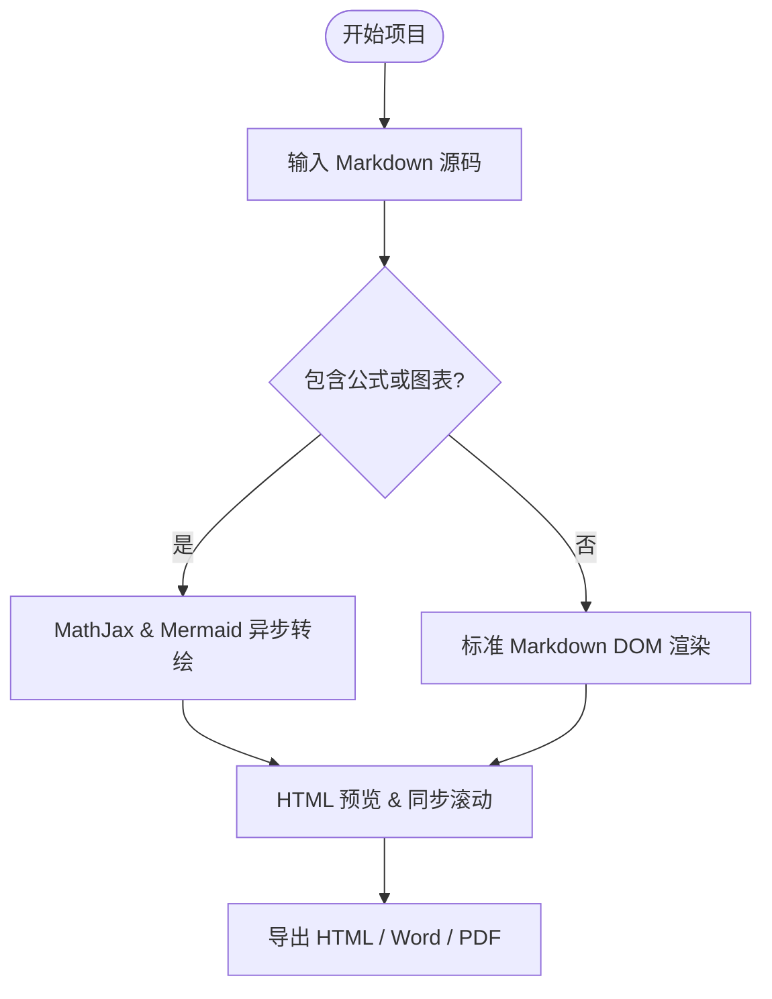
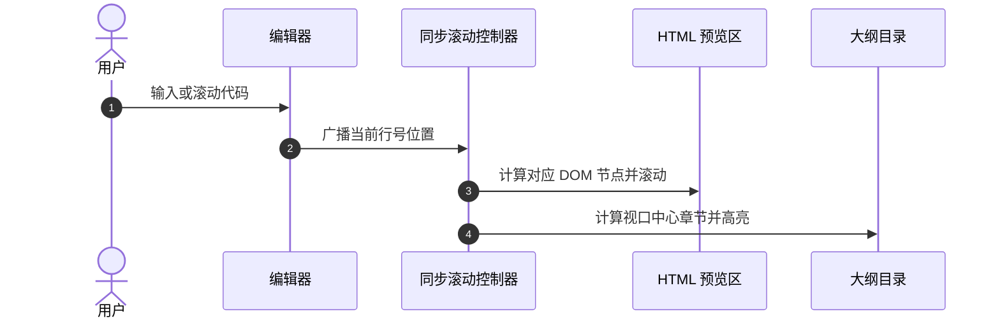
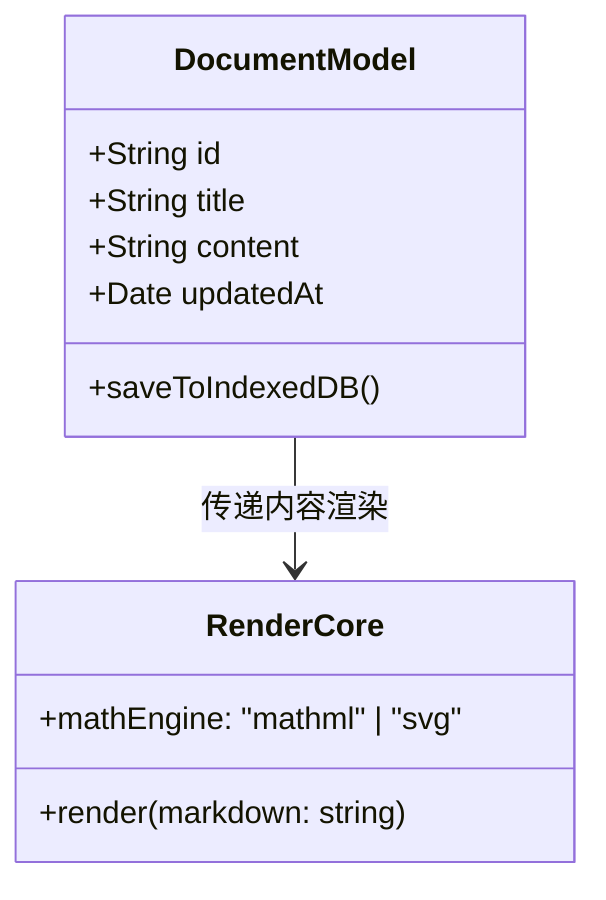
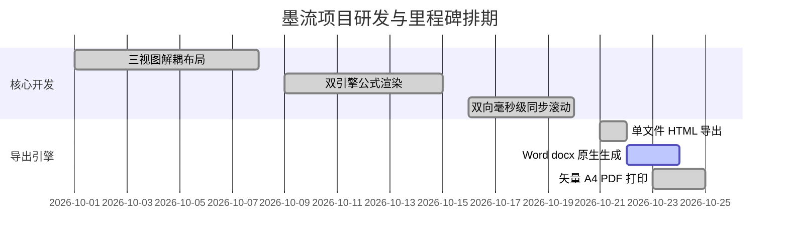

# MarkFlow (墨流) 完整使用教程与操作手册

本教程旨在帮助您全面掌握 **MarkFlow (墨流)** 的各项核心功能，从界面工作台的自由布局、数学公式与图表的高效撰写，到 A4 物理分页排版和多格式导出。

---

## 目录
1. [工作台界面与视图控制](#1-工作台界面与视图控制)
   - [三视图独立控制体系](#11-三视图独立控制体系)
   - [大纲悬浮侧边栏 (Rail) 的展开与收起](#12-大纲悬浮侧边栏-rail-的展开与收起)
   - [编辑器与 HTML 预览独立开关](#13-编辑器与-html-预览独立开关)
   - [可配置最大内容宽度 (Max Width)](#14-可配置最大内容宽度-max-width)
2. [双向同步滚动协同机制](#2-双向同步滚动协同机制)
   - [大纲导航与双屏同步居顶](#21-大纲导航与双屏同步居顶)
   - [编辑器滚动驱动与大纲自动追踪](#22-编辑器滚动驱动与大纲自动追踪)
   - [预览区驱动与防抖锁](#23-预览区驱动与防抖锁)
3. [统一跨视图工具栏与快捷输入](#3-统一跨视图工具栏与快捷输入)
   - [按钮悬浮提示 (Tooltips) 与折行设计](#31-按钮悬浮提示-tooltips-与折行设计)
   - [快捷插入格式与代码块](#32-快捷插入格式与代码块)
4. [深度数学公式排版 (LaTeX)](#4-深度数学公式排版-latex)
   - [行内公式与块级公式](#41-行内公式与块级公式)
   - [MathML 与 SVG 双引擎切换与适用场景](#42-mathml-与-svg-双引擎切换与适用场景)
   - [常用高级数学符号与矩阵排版速查](#43-常用高级数学符号与矩阵排版速查)
5. [图表与可视化绘制 (Mermaid)](#5-图表与可视化绘制-mermaid)
   - [流程图 (Flowchart)](#51-流程图-flowchart)
   - [时序图 (Sequence Diagram)](#52-时序图-sequence-diagram)
   - [类图与状态图 (Class & State)](#53-类图与状态图-class--state)
   - [甘特图 (Gantt Chart)](#54-甘特图-gantt-chart)
6. [A4 分页模拟与物理排版实战](#6-a4-分页模拟与物理排版实战)
   - [连续流式模式 vs A4 仿真分页模式](#61-连续流式模式-vs-a4-仿真分页模式)
   - [物理分页符插入指南](#62-物理分页符插入指南)
   - [打印样式优化与分页防断裂](#63-打印样式优化与分页防断裂)
7. [多格式专业导出指南](#7-多格式专业导出指南)
   - [导出单文件独立 HTML](#71-导出单文件独立-html)
   - [导出 Microsoft Word (.docx)](#72-导出-microsoft-word-docx)
   - [导出矢量 A4 PDF (浏览器打印)](#73-导出矢量-a4-pdf-浏览器打印)
8. [本地优先存储与文档管理](#8-本地优先存储与文档管理)
   - [IndexedDB 自动持久化](#81-indexeddb-自动持久化)
   - [新建、切换与重命名文档](#82-新建切换与重命名文档)
   - [外部 Markdown 文件导入与备份导出](#83-外部-markdown-文件导入与备份导出)
9. [常见问题解答 (FAQ)](#9-常见问题解答-faq)

---

## 1. 工作台界面与视图控制

MarkFlow 提供了高度灵活的工作区布局体系，无论是宽屏双栏对照、专注纯写 Markdown、大屏沉浸式阅读，还是配合大纲精准导航，都可以一键达成。

```
+-------------------------------------------------------------------------+
| [MarkFlow 墨流] [文档选择/标题]             [宽度:1024px] [主题] [导出]  |
+-------------------------------------------------------------------------+
| [统一工具栏: H1 H2 加粗 斜体 公式 表格 Mermaid...] [编辑器:开] [预览:开]  |
+---------+-----------------------------------+---------------------------+
| 大纲    | 源代码编辑器 (Markdown)           | HTML 渲染预览区           |
| (可收起) | (最大 1024px 水平居中)             | (流式 / A4 页面仿真)      |
|         |                                   |                           |
| # 章节1 | ## 1. 简介                        | 1. 简介                   |
| ## 1.1  | 这是正文段落...                    | 这是正文段落...           |
|         |                                   |                           |
+---------+-----------------------------------+---------------------------+
| 状态栏: 字数: 1,280 | 行数: 84 | 已自动保存到本地 IndexedDB              |
+-------------------------------------------------------------------------+
```

### 1.1 三视图独立控制体系
工作台包含三大独立视区：
1. **大纲视图 (Outline Tree)**：提取文档中的 `#` 至 `######` 标题层级，支持点击跳转与高亮指示；
2. **源码编辑器 (Markdown Editor)**：带行号的高性能文本编辑区域；
3. **HTML 预览区 (HTML Preview)**：实时排版渲染区，支持连续流式与标准 A4 分页视图。

三个视图彼此解耦，可以根据不同的任务形态自由组合切换：
- **经典技术双屏写作**：大纲开 + 编辑器开 + 预览开
- **纯粹写作模式**：大纲关 + 编辑器开 + 预览关
- **专注校对与阅读**：大纲开 + 编辑器关 + 预览开
- **大屏对照编辑**：大纲关 + 编辑器开 + 预览开

### 1.2 大纲悬浮侧边栏 (Rail) 的展开与收起
- **收起大纲**：点击大纲顶部的收起按钮（或侧边栏上的切换图标），大纲栏平滑折叠为极细的 **侧边操作 Rail**。
- **展开大纲**：在折叠状态下，点击侧边 Rail 上的大纲图标，大纲目录即刻滑出，不占用干扰核心写作空间。

### 1.3 编辑器与 HTML 预览独立开关
在顶部跨视图工具栏右侧，设有明确的状态开关：
- **「编辑器」开关**：控制源码编辑器列的显示或隐藏；
- **「预览」开关**：控制 HTML 实时预览列的显示或隐藏；
- **防全关保护**：当您尝试关闭最后一个内容视窗时，系统会自动保护保持至少一个内容视图可见，避免空屏。

### 1.4 可配置最大内容宽度 (Max Width)
在超宽显示器（2K / 4K / 带宽屏）上，全屏拉伸的文本行往往过长，容易造成视觉疲劳与阅读跳行。
- MarkFlow 默认将编辑器与 HTML 渲染容器的最大宽度设定为黄金排版宽度 **1024px** 并自动居中对齐；
- 顶部导航栏提供了 **宽度配置下拉菜单**，您可按需选择：
  - **800px**：适合专注短文、论文阅读与狭窄视窗；
  - **1024px (推荐默认)**：技术文档与学术材料的黄金可读宽度；
  - **1200px**：适合包含大型数据表格或宽幅图表的长篇文档；
  - **1440px**：针对大尺寸桌面屏幕的扩展视野；
  - **100% 全宽**：完全填充父容器，最大化屏幕利用率。

---

## 2. 双向同步滚动协同机制

MarkFlow 引入了基于 AST 块映射与百分比插值的毫秒级同步滚动算法，彻底解决了传统编辑器中“大图/多行公式挤占空间导致滚动脱节”的问题。

### 2.1 大纲导航与双屏同步居顶
当在左侧大纲树中点击任意标题：
- **编辑器** 将自动平滑滚动至对应标题所在的代码行，并使该行位于可视区域顶部；
- **HTML 预览区** 将同步平滑滚动至对应的渲染标题 DOM 节点并居顶对齐；
- 两个视图同时就位，无需手动多次拉动对齐。

### 2.2 编辑器滚动驱动与大纲自动追踪
- 当在编辑器中向上或向下滚动时，系统会计算当前视窗中心所对应的源码块；
- **HTML 预览区** 毫秒级跟进至对应渲染内容；
- **大纲视图** 会实时定位当前视口中央所属的章节，并施加**加粗边框与高亮背景**，让您随时知晓当前阅读处于整篇文档的哪一部分。

### 2.3 预览区驱动与防抖锁
- 当您在 HTML 预览区拖动滚动条或使用鼠标滚轮翻阅时，编辑器视图也将同步翻滚至对应的源码段落；
- 内置 **滚动反馈互斥锁 (Feedback Lock)**：当一侧触发滚动广播时，接收侧会在滚动动画期间暂停反向发送，完全杜绝了双向互相驱动导致的“页面抖动”或“死循环回弹”。

---

## 3. 统一跨视图工具栏与快捷输入

### 3.1 按钮悬浮提示 (Tooltips) 与折行设计
- 工具栏横跨整个编辑与预览区域顶部，采用微型图标 + 悬浮提示层 (Tooltip) 设计；
- 鼠标悬停在任何图标上方时，即刻弹出清晰的功能中文说明与快捷键提示，不占用多余横向空间；
- 在较小视窗或缩放比例下，工具栏具备自适应折行能力，永不遮挡截断内容区。

### 3.2 快捷插入格式与代码块
| **H1 ~ H3 标题** | `# 一级标题` 至 `### 三级标题` (高频单击直出) | - |
| **H4 ~ H6 更多标题** | 展开微型下拉按钮选择 `####` 至 `######` 标题 | - |
| **加粗** | `**重点文字**` | `Ctrl / Cmd + B` |
| **斜体** | `*倾斜文字*` | `Ctrl / Cmd + I` |
| **删除线** | `~~删除内容~~` | - |
| **引用块** | `> 引用文字内容` | - |
| **无序/有序列表** | `- 项目` 或 `1. 项目` | - |
| **待办任务清单** | `- [ ] 待完成事项` | - |
| **插入表格** | 8×6 可视化交互矩阵选择器与预设模板 | `Alt + T` / `Ctrl + Shift + T` |
| **数学公式 (行内)** | `$E = mc^2$` | `Alt + M` |
| **数学公式 (块级)** | `$$\int_a^b f(x)dx$$` | `Alt + Shift + M` |
| **Mermaid 流程图** | 预置 Flowchart 结构模板 | - |
| **代码块** | 插入带语法高亮的代码围栏 ` ```ts ` | - |
| **物理分页符** | 插入 `<div class="page-break"></div>` | - |

---

## 4. 深度数学公式排版 (LaTeX)

MarkFlow 内置 MathJax 3 渲染核心，深度适配标准 LaTeX 数学表达规范。

### 4.1 行内公式与块级公式
- **行内公式 (Inline)**：使用单个美元符号包裹 `$ ... $`。
  例如：`质能守恒定律为 $E = mc^2$，薛定谔方程核心为 $i\hbar \frac{\partial \psi}{\partial t} = \hat{H}\psi$。`
- **块级独立公式 (Block/Display)**：使用双美元符号包裹 `$$ ... $$`。
  例如：
  ```markdown
  $$
  \nabla \times \mathbf{E} = -\frac{\partial \mathbf{B}}{\partial t}
  $$
  ```

### 4.2 MathML 与 SVG 双引擎切换与适用场景
在右侧 HTML 预览区顶部，您可以随时点击切换 **MathML** 或 **SVG** 渲染模式：

| 引擎特性 | 原生 MathML 引擎 | 矢量 SVG 引擎 |
| :--- | :--- | :--- |
| **渲染原理** | 编译为标准 W3C `<math>` 标签由浏览器内核渲染 | 将公式字符编译为高保真 SVG 路径矢量绘制 |
| **加载性能** | 极速，毫秒级即刻完成，内存开销小 | 精确逐字形生成，略多微秒级计算 |
| **选中复制** | 支持像普通文本一样直接鼠标拖拽选中公式字符并复制 | 呈现为纯图形对象，不破坏页面文本流 |
| **打印与缩放** | 字体跟随系统，放大时清晰无锯齿 | 绝对矢量保真，在超高清打印与放大镜下无瑕疵 |
| **推荐适用场景** | 日常阅读、编写长篇教材、海量公式文档 | 学术论文精细排版、出版物打印、导出 PDF |

### 4.3 常用高级数学符号与矩阵排版速查

#### 1. 分式与根式
```markdown
$$
\frac{-b \pm \sqrt{b^2 - 4ac}}{2a}
$$
```

#### 2. 微积分与积分限
```markdown
$$
\int_{-\infty}^{+\infty} e^{-x^2} \, dx = \sqrt{\pi}
$$
```

#### 3. 矩阵与行列式
```markdown
$$
\mathbf{A} = \begin{pmatrix}
a_{11} & a_{12} & \cdots & a_{1n} \\
a_{21} & a_{22} & \cdots & a_{2n} \\
\vdots & \vdots & \ddots & \vdots \\
a_{m1} & a_{m2} & \cdots & a_{mn}
\end{pmatrix}
$$
```

#### 4. 分段函数
```markdown
$$
f(x) = \begin{cases}
x^2 \sin\left(\frac{1}{x}\right) & \text{当 } x \neq 0 \\
0 & \text{当 } x = 0
\end{cases}
$$
```

---

## 5. 图表与可视化绘制 (Mermaid)

只需声明代码块语言为 `mermaid`，MarkFlow 即可自动转绘为响应式自适应矢量图表。

### 5.1 流程图 (Flowchart)
````markdown

````

### 5.2 时序图 (Sequence Diagram)
````markdown

````

### 5.3 类图与状态图 (Class & State)
````markdown

````

### 5.4 甘特图 (Gantt Chart)
````markdown

````

---

## 6. A4 分页模拟与物理排版实战

### 6.1 连续流式模式 vs A4 仿真分页模式
在 HTML 预览区右上角，提供了 **「连续流式」** 与 **「A4 分页」** 的双态切换按钮：
- **连续流式**：网页端常见的无限垂直滚动流，随窗口宽度自然换行，适合快速阅读与编写；
- **A4 分页模式**：精确模拟真实的物理 A4 纸张（宽 210mm，高 297mm），带有柔和阴影纸张边界与标准版心边距（上25mm，下20mm，左右20mm）。

### 6.2 物理分页符插入指南
当需要强制另起新页（例如封面结束、章节独立成页）时：
1. 点击工具栏的 **「插入分页符」** 按钮；
2. 或者在正文中直接手动写入标准分页标签：
   ```html
   <div class="page-break"></div>
   ```
在 A4 预览视图与打印导出时，该标记后的所有内容都会干净利落地推入下一张 A4 纸张的顶部起始位置。

### 6.3 打印样式优化与分页防断裂
MarkFlow 内置了印刷级 CSS 断页规则：
- 标题标签 `h1, h2, h3` 自动设置 `break-after: avoid`，绝不会发生“标题孤悬在页面最底部、下一页才是正文”的尴尬排版错误；
- 表格 `table`、公式块与代码块自动具备 `break-inside: avoid`，尽可能防止同一块内容被纸张边缘腰斩。

---

## 7. 多格式专业导出指南

点击顶部导航栏右上角的 **「导出」** 按钮，即可打开综合导出面板。

### 7.1 导出单文件独立 HTML
- **特点**：无需任何外部依赖或 CDN。
- **内嵌内容**：所有排版 CSS 样式、暗色/亮色色彩配置、已渲染的 MathML/SVG 公式及 Mermaid 图表全部内嵌打包进单个 `.html` 文件中；
- **使用体验**：通过微信、邮件直接发给他人，对方双击用任何浏览器均可完整打开查看，离线亦可完美呈现。

### 7.2 导出 Microsoft Word (.docx)
- **特点**：真正的原生 Office 开放 XML 格式，可在 Microsoft Word、WPS Office、Google Docs 中直接编辑；
- **排版保留**：
  - H1 ~ H6 对应 Word 的标准标题大纲级别，在 Word 导航窗格中自动生成大纲；
  - 表格转换为 Word 原生网格表格，并配置表头底色与边框；
  - 任务清单与引用块转换为对应样式的列表与缩进段落；
  - 代码块应用等宽字体与轻灰色代码底纹。

### 7.3 导出矢量 A4 PDF (浏览器打印)
- 点击 **「打印 / 导出 PDF」** 或按下快捷键 `Ctrl / Cmd + P`；
- 系统自动呼出浏览器的标准打印对话框；
- **配置建议**：
  - **目标打印机**：选择「另存为 PDF」；
  - **纸张尺寸**：选择「A4」；
  - **边距**：选择「无」或「默认」（MarkFlow 内部样式已精准计算页边距）；
  - **选项**：勾选「背景图形」（确保公式底色、代码块背景和表格样式正确呈现）。

---

## 8. 本地优先存储与文档管理

### 8.1 IndexedDB 自动持久化
- MarkFlow 不强制要求登录云端账号，所有文档草稿与历史记录均保存在您本机浏览器的 **IndexedDB** 数据库中；
- 每次输入停止 **300ms** 后自动静默保存，状态栏显示「已保存到本地」；
- 即使误关标签页、误按刷新键或电脑意外断电，重新打开网站即可无缝恢复当前编辑现场。

### 8.2 新建、切换与重命名文档
- 点击顶部左侧的 **「文档清单」** 图标，即可呼出文档管理抽屉；
- 支持创建全新的空白文档、载入内置的丰富技术范本（学术论文范本、工程技术白皮书、Mermaid 架构设计图等）；
- 双击标题栏文本即可随时为当前文档重命名。

### 8.3 外部 Markdown 文件导入与备份导出
- **导入**：支持将本机的 `.md` 文件拖拽或点击导入至工作台；
- **导出备份**：可一键将当前文档保存为原始 `.md` 文件，方便纳入 Git 版本控制。

---

## 9. 常见问题解答 (FAQ)

**Q1：为什么在小屏幕上，工具栏不会把内容截断？**  
A1：MarkFlow 采用了自适应弹性工具栏设计，所有长按钮已转为直观精简图标并辅以浮动悬停提示，在宽度受限时会自动平滑折行，且独立覆盖在双视图上方。

**Q2：如何临时获得全屏的阅读视野？**  
A2：点击左侧 Rail 收起大纲，并在顶部工具栏将「编辑器」开关关闭，即可立即获得 100% 专注的纯净预览阅读屏。

**Q3：公式很多时长文档会不会卡顿？**  
A3：推荐在右侧预览区右上角切换至 **MathML 原生引擎**，该引擎直接调用浏览器的原生渲染管线，即便渲染数千个复杂公式也十分轻快流畅。

**Q4：打印 PDF 时如何隐藏不想打印的界面元素？**  
A4：MarkFlow 配备了专门的 `@media print` 媒体查询规则，打印时侧边大纲、顶部导航栏、工具栏、状态栏和滚动条均会被自动剥离，只纯粹呈现正文 A4 内容。

---

*祝您在 MarkFlow (墨流) 中创作愉快！*
