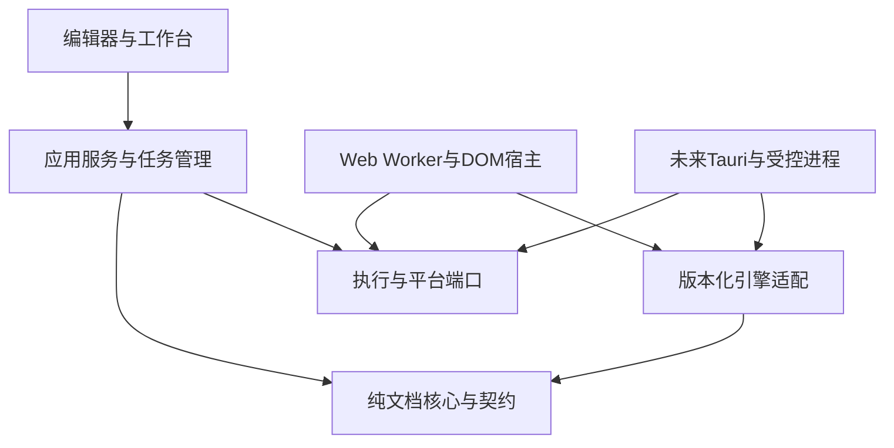

# MarkFlow 架构重构方案：文档任务管理与平台适配

本步实施补充（2026-10-26）：V2已审查验证，见[V2执行记录](../reviews/architecture-v2-implementation-2026-10-26.md)。历史进度条目以最新补充为准。

本步实施补充（2026-10-26）：V1已审查验证，见[V1执行记录](../reviews/architecture-v1-implementation-2026-10-26.md)。历史进度条目以最新补充为准。

本步实施补充（2026-10-26）：P5已审查验证，见[P5执行记录](../reviews/architecture-p5-implementation-2026-10-26.md)。历史进度条目以最新补充为准。

本步实施补充（2026-10-26）：P4已审查验证，见[P4执行记录](../reviews/architecture-p4-implementation-2026-10-26.md)。历史进度条目以最新补充为准。

本步实施补充（2026-10-26）：P3已审查验证，见[P3执行记录](../reviews/architecture-p3-implementation-2026-10-26.md)。历史进度条目以最新补充为准。

本步实施补充（2026-10-26）：P2已审查验证，见[P2执行记录](../reviews/architecture-p2-implementation-2026-10-26.md)。历史进度条目以最新补充为准。

导出语义补充（2026-10-26，仅设计更新）：各格式统一导出入口，不增加PDF专属打印预览；工作台A4视图可选，不是导出前置条件。以下第6节及配套计划P5/E10为当前要求，历史记录中的打印表述不新增产品流程或实体打印验收义务。本轮未修改代码。

最新实施补充（2026-10-26）：R0、R1组件已审查验证（2243c5f、95183fb）；R2已审查验证，记录随本次提交归档；详见[执行记录](../reviews/architecture-r0-r1-implementation-2026-10-25.md)。R2见[R2执行记录](../reviews/architecture-r2-implementation-2026-10-25.md)，R3a已审查验证，见[R3a执行记录](../reviews/architecture-r3a-implementation-2026-10-25.md)；R3b已审查验证，见[R3b执行记录](../reviews/architecture-r3b-implementation-2026-10-25.md)；R4已审查验证，见[R4执行记录](../reviews/architecture-r4-implementation-2026-10-25.md)；R5已完成审查与回归收口，见[R5审查记录](../reviews/architecture-r5-review-2026-10-25.md)；U3a会话组件已审查验证，见[U3a执行记录](../reviews/architecture-u3a-implementation-2026-10-25.md)；U3b统一切换组件已审查验证，见[U3b执行记录](../reviews/architecture-u3b-implementation-2026-10-25.md)；U4a内存缓存组件已审查验证，见[U4a执行记录](../reviews/architecture-u4a-implementation-2026-10-25.md)；U4b完成提交组件已审查验证，见[U4b执行记录](../reviews/architecture-u4b-implementation-2026-10-25.md)；U5a单计算Worker纵向组件已审查验证，见[U5a执行记录](../reviews/architecture-u5a-implementation-2026-10-25.md)；U5b真实双角色宿主已在独立夹具审查验证，见[U5b执行记录](../reviews/architecture-u5b-implementation-2026-10-25.md)；U6a共享DOM串行入口及可选准备阶段已在独立夹具审查验证，见[U6a执行记录](../reviews/architecture-u6a-implementation-2026-10-25.md)；U6b公式入口已切换到共享DOM并审查验证，见[U6b执行记录](../reviews/architecture-u6b-implementation-2026-10-25.md)；U6c图表入口已切换到共享DOM并审查验证，见[U6c执行记录](../reviews/architecture-u6c-implementation-2026-10-26.md)；U6d分页入口已切换到共享DOM并审查验证，见[U6d执行记录](../reviews/architecture-u6d-implementation-2026-10-26.md)；U6e已接入编辑器下方真实Tab栏、会话/统一切换、唯一内存缓存及生产前后台流水线并完成审查验证，见[U6e执行记录](../reviews/architecture-u6e-implementation-2026-10-26.md)；U6f已完成新产物的源码区间同步、大纲定位/高亮、视图恢复及布局设置回归，见[U6f执行记录](../reviews/architecture-u6f-implementation-2026-10-26.md)；P1已完成文件读取/导入busy、格式校验及来源修订保存接入，见[P1执行记录](../reviews/architecture-p1-implementation-2026-10-26.md)；P2及后续尚未实施。以下阶段表描述目标范围；早先“未实施”的状态以本补充为准，不改变草案6路线。

草案6规划时记录（历史状态，当前实施进度以上方补充为准）：文档编号：AR-01；草案版本：6；日期：2026-10-25（Asia/Shanghai）。状态：A2、U0—U2历史组件已验证；草案6收缩任务治理并统筹接入路线，R0—R5及U3—U6/A5/A7完整路线已规划，尚未实施；本轮仅改文档，不提交、不推送。

设计冻结时的代码基线：typescript-strict / 75261ae1e532630a5a5859c397110f31698964af。基线完整审查已记录76项单元、22项Chromium通过；这是历史代码验证，不是本方案已经实现或通过验收。

当前规范以草案6第3—9、13节及[收缩审查](../reviews/architecture-simplification-review-2026-10-25.md)为准；后附实施记录是历史事实，不是继续接入原复杂模型的要求。

配套文档：[技术栈评估](architecture-stack-assessment-2026-10-25.md)、[分步实施与验收](architecture-implementation-acceptance-2026-10-25.md)。既有依据：[总体设计](Markdown编辑器总体设计方案_V0.2.10.md)、[严格化审查](../reviews/typescript-strict-review-2026-10-25.md)、[审查证据](../acceptance/typescript-strict-review-evidence.json)。

## 1. 目标与范围

建立满足MarkFlow当前文档处理需求的健壮任务管理机制：Markdown解析、公式和图表生成、流式预览、A4分页、HTML/DOCX/PDF导出。保持编辑器、多文档、三视图同步、显隐/宽度设置和本地优先能力。

现代化指标准能力、明确边界、可隔离执行、可维护发布；严格化同时包含编译期类型、运行时数据契约及生命周期约束。版本新旧不是独立替换依据。现有技术栈先作为功能基线，适配不足与库能力不足分别处理。

原方案编制与审查阶段只修改文档。用户后续已授权在architecture-refactor分支开始完整重构，此前已完成A0/A1和旧模型A2并按步骤本地提交；本次仅审查过度设计并同步收缩方案；不推送、不合并、不移动标签、不升级MathJax、不替换Paged.js。[A0记录](../reviews/architecture-a0-baseline-2026-10-25.md)与[A1记录](../reviews/architecture-a1-implementation-2026-10-25.md)区分已执行与后续规划，不把A1的Worker导入烟测当作A3生产任务接入。

### 1.1 需求标识

| 标识 | 需求 |
| --- | --- |
| AR01 | 文档核心、任务管理、执行器、平台服务的依赖方向明确且可检查 |
| AR02 | 预览按当前文档与最新输入发布，旧任务不得覆盖新结果 |
| AR03 | 导出冻结输入、选项和资源授权，实际使用资源解析后固定，不混用后续编辑 |
| AR04 | 区分结果失效、取消请求、执行停止、超时及宿主故障 |
| AR05 | 任务资源责任和执行器占用可追踪，失败及重启后能够回收 |
| AR06 | Worker异常可终止/重建，后续任务可继续；DOM执行能力如实标识 |
| AR07 | Web开箱可用及普通HTTP路径保留，未来Tauri接入不改写领域规则 |
| AR08 | 类型严格、跨边界消息校验、可复现故障测试和验收证据 |
| AR09 | 仅在能力缺口和对照验证支持下替换技术栈，按步骤可回退 |
| AR10 | 多Tab单激活，文档会话独立；任务按文档归属、合并与取消 |
| AR11 | 切回Tab优先恢复有效预览产物，缓存有界且不丢失编辑状态 |
| AR12 | 预留版本化缓存与平台存储边界，持久化缓存后续接入，无需改写任务生命周期 |

### 1.2 规范效力与既有需求

这三份文件是现有总体设计和产品版本规划的架构补充，不取代产品范围。冲突按用户本会话最新确认、本补充的明确约束、既有方案依次解释；未明确调整的既有需求继续有效。总体设计中的技术目标不是当前实现证明。

| 既有事项 | 本轮解释与实施边界 |
| --- | --- |
| MathJax 4.x、CodeMirror及Shiki目标 | 当前代码仍以MathJax 3.2.2和textarea为迁移基线；用户明确暂不升级MathJax。本轮不替换编辑器，不取消高亮、输入法、撤销、查找替换等既定需求 |
| Worker、区块复用与M1–M4优化 | 既有Worker/基础复用需求仍需逐项追踪；本次先接解析Worker和整篇产物缓存，不以此声称完成Shiki/Graphviz Worker或公式级优化。原文中首版优化表述的差异按既有13.2节及最新确认区分，不能悄悄取消未完成的基线要求 |
| PWA/整应用离线 | 不在本轮新建PWA，但仍是既有1.0放行范围；静态资源齐备、普通HTTP可运行不等于PWA离线已验收 |
| 插件机制 | 保留构建时受信任语法/渲染/导出适配注册及按需加载；不开放任意用户任务/DAG或远程脚本。插件只产出候选产物和诊断，不拥有调度、发布或文件权限 |
| 输出与格式诊断 | MD/资源包、HTML、PDF、基础DOCX按原范围追踪；DOCX公式图片及明确降级保留，OMML/自动PDF/PPTX/EPUB仍后续 |
| HTML H0–H4与界面规范 | H0/H1按已选特性和五层能力验收，H2–H4仍后续；三视图不自动隐藏、设置弹窗和1024默认最大宽度不变 |

A0建立产品需求清单，逐项标注“当前已证实、此次实现、另行补齐、后续范围”。架构步骤结束不等于整个1.0范围已完成；缺失的基线功能须在0.9.x开发补齐，不能推入1.0验证阶段。

### 1.3 本轮规划不扩展的范围

不建设通用任务平台、分布式队列、远程任务服务、可编程工作流或任意作者JS插件。Redis、通用编排框架、持久化任务历史和跨机器调度不是前置依赖。PPT/EPUB、任意脚本HTML、H2–H4、PWA整应用离线、编辑器功能迁移仍分别管理。

本次采用多Tab单激活、前台/后台各一个Worker及各自串行队列，完整产物存入内存缓存，切换优先更替缓存指针。关闭后重开、应用重启后的预览缓存恢复及持久化缓存留待后续；它们不影响既有源文档持久化。跨修订公式缓存、区块缓存、视口优先和增量A4等细粒度优化继续保留为后续事项。合并未执行的过期预览、拒收迟到结果、限制队列属于本次正确性和资源边界，不以此宣称已实现高级性能优化。

## 2. 当前架构与实际问题

| 现状 | 代码依据 | 重构动机 |
| --- | --- | --- |
| 文档渲染、Mermaid和分页各维护Promise队列 | documentRenderer.ts、mermaidRender.ts、documentPaginator.ts | 需要明确单一调度入口、完成核对和局部清理 |
| schema导入渲染层，渲染策略导入时使用window | documentSchema.ts → htmlPolicy.ts → DOMPurify(window) | 纯数据校验无法直接在Worker中加载 |
| Markdown解析器调用公式缓存和DOM净化 | markdownParser.ts、mathRender.ts、htmlPolicy.ts | 解析、生成和浏览器宿主交织，难以独立执行 |
| 公式使用共享MathJax状态和会话级缓存 | mathRender.ts、mathJaxAdapter.ts | 当前文档串行规则必须保留，不能盲目并发化 |
| Mermaid需要DOM和计算样式 | mermaidRender.ts | 不是直接可迁入Worker的纯函数 |
| 分页直接访问主文档样式和隐藏DOM | documentPaginator.ts | 任务与界面共享故障/布局环境 |
| 超时只能限制等待，部分底层工作仍继续 | withDeadline及分页延迟清理 | 正确拒收不等于停止执行或释放租约 |
| 导出使用DOM测量、生成及交付 | htmlExporter.ts、docxExporter.ts、documentPrint.ts | 纯生成、布局和平台文件操作需要分离 |
| 持久化读取仍有强转/未完全校验路径 | storage.ts | strict不能替代运行时文档与迁移校验 |

这些是结构性改造依据，不推翻既有审查中的已验证修复。76/22的回归基线应继续保留。

## 3. 模块边界与依赖方向

采用同仓库模块化，初期不拆monorepo、独立npm包或服务进程。下列目录为目标组织建议，不代表当前存在。

| 目标模块 | 职责 | 允许依赖 | 禁止依赖 |
| --- | --- | --- | --- |
| core/document | 文档、主题、资源schema，版本与源范围，语义中间表示 | 纯TS、Zod、必要纯CSS值校验 | React、DOM、Window、Tauri、具体存储 |
| core/parse | Markdown→语义树，大纲、公式/图表节点提取与sourceRange | 文档契约、unified生态 | 公式生成器、DOMPurify、全局缓存、UI |
| core/output | 目标格式契约、适配诊断、纯序列化和输出计划 | 文档/产物契约 | 任意文件路径写入、UI状态、全局document |
| application/sessions | Tab顺序、唯一activeTabId、文档会话、编辑状态与预览引用 | 纯会话契约、任务/缓存端口 | 引擎实例、隐藏DOM、具体存储SDK |
| application/previewCache | 完整产物索引、同步匹配、简单预算与淘汰 | 文档/产物契约、注入时钟、缓存后端端口 | React、DOM节点、Worker、引擎全局状态 |
| application/tasks | 最小任务身份、输入快照、双串行调度、完成核对和清理 | 纯契约、执行/平台端口、注入时钟 | Worker构造、DOM、Bun/Tauri API及具体库内部状态 |
| engines | MathJax/Mermaid/分页/DOCX等版本化适配 | 纯契约、对应运行环境API | React状态、任务队列所有权、全局用户授权 |
| runtime/web | Worker、DOM宿主、消息通道及浏览器生命周期 | 任务端口、引擎适配、Web API | Tauri文件系统/进程接口 |
| platform/web | 浏览器存储、文件导入、下载、打印、资源读取 | 文档契约、Web API | 修改任务的领域判定规则 |
| platform/tauri（未来） | 本地文件/目录、权限令牌、原子提交、受控进程 | 同一平台端口、Tauri/Rust实现 | UI临时状态、任意无范围文件访问 |
| ui | 编辑交互、任务状态、三视图和结果展示 | 应用服务、只读快照、DOM视图 | 直接调用MathJax/Paged.js或绕过任务服务执行导出 |

组合入口负责注入适配器：UI → application → ports ← Web/Tauri具体实现。引擎只生成候选产物，不直接发布预览、写文件或触发下载。净化策略拆为纯规则/诊断契约与DOM净化实现，避免用模拟window掩盖依赖问题。

### 3.1 文档与产物

Markdown及文档记录仍是编辑权威来源；语义树、HTML/MathML/SVG、分页结果和DOCX均为派生产物。语义树保存nodeId、sourceRange和节点种类；渲染产物保留data-node-id及行范围映射，重构不得退回仅按全文百分比同步。

源文档模型与schema逐步形成单一可核对定义；跨Worker消息和持久化数据必须从unknown校验后进入领域。损坏文档保留原始备份或隔离记录并显示恢复入口，不静默覆盖成空文档。迁移不得修改用户未选择的其他文档。

应用UI继续允许OKLCH；文档输出默认HEX/RGB。流式HTML、分页样式与DOCX适配分别验证，不能以CSS.supports=true证明导出支持。

### 3.2 多Tab文档会话

支持多个打开的Tab，但同一时刻只有一个激活文档工作区；这与工作区内大纲/编辑器/HTML三个同时可见视图是两个维度。初期同一文档只建立一个Tab，重复打开聚焦已有Tab；当前直接按documentId管理Tab，不为尚无需求的同文档多视图建立第二套身份。

DocumentSession保存documentId、当前内容修订、未保存状态、编辑状态/撤销历史，以及光标、选区、语义滚动锚点、预览需求和产物引用。Tab记录引用会话，不复制第二份编辑权威数据。编辑器状态可由其专用适配器持有，不跨Worker序列化；替换编辑器不改变任务消息契约。

会话区分currentRevision、draftPersistedRevision、sourceSavedRevision及lastDownloadDispatchedRevision；草稿已持久化不等于源文件已写回，Web下载发起也不等于确认磁盘保存。未保存提示按相应目标修订比较，不能只有一个模糊dirty布尔值。

切换Tab不卸载文档会话、不清空撤销历史，也不取消该文档的保存。保存服务按documentId串行写入并核对保存修订；A的迟到保存回执不能把B或A的新修改标为已保存。关闭Tab确认保存时，等待所选修订真正成功，失败保留会话；“导出成功”不清除源文未保存标志。会话仅存缓存键/产物ID等可失效引用，后台Tab不永久固定缓存，以免阻止LRU。关闭Tab先处理未保存修改和正在导出的任务，确认后作废该文档taskId、移除预览待办与视图引用；无其他消费者时释放产物引用。关闭后重开分配新的、不复用的taskId，旧任务不可发布或写回新会话。关闭/切换不能隐式丢弃未保存内容，内存预算不能通过自动关闭脏文档达成。

### 3.3 完整产物缓存与有效性

缓存仅保存完成校验的完整产物，不保存中间数据、DOM树、Worker或引擎实例。完成表示完整产物校验和缓存指针提交均已完成；仅计算返回但仍在校验/写入的任务属于未完成。flow/A4分别记录完成状态，不能用一个模式的完成冒充另一个模式。初期仅内存缓存，源文档/撤销状态由会话持有，不受缓存淘汰影响。

统一缓存键为(documentId, previewKind, mdHash, renderConfigVersion)。mdHash使用Markdown原文UTF-8字节的SHA-256，不隐式归一化换行，不能直接沿用调用者随意填写的contentFingerprint。renderConfigVersion是单一渲染配置版本，主题、公式模式、引擎/净化策略、插件、会影响产物的字体/宽度/A4参数或资源上下文改变时统一推进；不要求调用方逐一匹配多组动态指纹。documentId隔离不同文档/工作区，不作跨文档去重。revision、activationEpoch和executorGeneration不是长期缓存命中条件。

MD散列和配置版本匹配且条目存在时，更替当前产物指针，重新挂载/测量并恢复语义位置，不重新解析/生成公式或图表。布局环境影响生成时推进同一配置版本；仅视图位置变化不使内容失效。源散列改变，未完成任务丢弃并使用新输入重算；已完成旧条目保留为完整旧快照，新产物完成后原子更新缓存指针，不能将旧条目冒充新版本。未命中、超限或被LRU淘汰时按同一路径重新生成。

资源访问仍经既有平台权限边界。预览只以单一配置版本表达资源上下文/显式授权变化，撤权时失效并撤下相关产物；不在每次切Tab时展开复杂授权/资源匹配。相同远端URL不保证字节永远相同，显式刷新/已知资源变化推进版本；不承诺仅凭MD散列检测远端变化。导出的冻结授权和资产校验保持独立要求。

缓存持有完整产物字节，视图只持引用；切换视图释放引用，不删除缓存。缓存不得保留隐藏宿主、监听器或Blob URL。保留条目/LRU/估算字节及活动/进行中总预算，脏文档不自动关闭；冻结A0数值仅为历史起点；真实接入时测量运行开销，不以JSON乘3或每Worker16MiB估算声称物理内存受控。缓存恢复仍可能发生DOM挂载、资源就绪检查和布局，不承诺零浏览器排版。

### 3.4 统一Tab切换流程

切换流程对每次切换相同，不另设“再次切回”或“快速切换”分支。

| 时点/状态 | 必须执行的动作 |
| --- | --- |
| 切出：所需模式已完成 | 保留完整缓存，解除当前视图引用；不重新渲染 |
| 切出：所需模式未完成 | 立即作废本次任务并丢弃中间结果，停止路径由切换协调器调用；后台按最新散列/配置建立一个新待办，从头生成 |
| 切入：后台有该文档未完成任务 | 无论排队还是执行中均移除/作废，执行中先停止并清理；不把执行状态或中间数据迁移给前台 |
| 切入：存在有效完整缓存 | 直接访问缓存并更替当前指针；不为同一有效产物创建生成任务 |
| 切入：无有效缓存 | 按当前原文与配置版本建立前台新任务 |
| 后台空闲 | 从后台FIFO队列取一项执行 |
| 后台已有其他文档任务 | 保持该任务执行，新待办等待；切换不打断无关后台任务 |

后台待办按(documentId, previewKind)合并，每键一个最新待办，保留FIFO位置；流式/A4只是同一Worker内的串行任务，不并行运行。任务开始读取该文档最新原文与配置，核对散列；内容已变则更新待办。运行中的同文档内容/配置失效时丢弃并重排，不接续旧中间结果。后台待办只保存文档/模式等轻量引用，容量自然受打开文档数与模式数约束；前台仅保留最新需求，不按排队时间使需求过期。

后台新任务完整完成后可提交该文档缓存，不要求文档处于激活状态；后台不直接更新当前视图。作废前台/后台任务的迟到结果都不能复活或写缓存。只在队列入口、切换、完成提交和视图挂载边界核验文档归属、任务票据、散列和配置版本，不把切换策略分散到各生成步骤。停止未确认时不复用同一执行器；可协作停止或终止并重建由执行器适配器封装，UI只调用统一切换接口。

### 3.5 当前内存缓存与后续扩展

当前使用同步内存Map，提供lookup、put、invalidate、evict和简单统计；不预建异步后端、acquire/release租用或恢复票据协议。完成回调核对仍有效的taskId及缓存键，经完整校验后同步入库；展示再核对当前documentId。后台可以缓存，不能直接替换当前视图。

保持产物可序列化、缓存键含schema版本，未来在应用服务与存储适配边界增加持久化，不让UI直接依赖IndexedDB/Tauri。持久化异步恢复、损坏缓存迁移和关闭重开恢复届时再设计、验证；源文档存储恢复要求不变。

## 4. 有限任务模型与执行器契约

### 4.1 只保留两类用户任务

| 用户任务 | 有限内部步骤 | 调度与发布 |
| --- | --- | --- |
| preview.flow / preview.a4 | 解析、生成、资源准备、净化、布局/分页 | 最新输入优先，只有当前期望快照可发布 |
| export.md / export.mdBundle / export.html / export.docx / export.print | 固定输入、解析资源、生成、布局、打包、交付 | 使用提交时快照；后续编辑不改变本次导出 |

MD纯文本导出可绕过渲染，资源包按源引用重写和冻结资产打包；不强制它们使用预览身份和生命周期，仍遵守导出busy、快照及清理规则。源文件保存/自动保存属于文档服务，不伪装成预览任务，也不因导出而改变源关联。

内部步骤可以复用执行器，但不提供用户自定义DAG或任务插件注册表。按格式实现明确流水线即可。

### 4.2 最小输入与消息边界

预览仅携带protocolVersion、taskId、documentId、previewKind、mdHash、renderConfigVersion与执行所需输入。taskId应用内不复用，替代、关闭、相关Tab切换时作废；activeDocumentId在展示边界检查。源revision仍用于编辑/保存，不作为预览缓存命中条件。不再要求snapshotId、多组指纹、activationEpoch、restore ticket和逐层executor代际链。

外部文件、持久化数据和Worker消息从unknown校验；已验证的内部对象用严格类型传递，不在队列每层重复parse、clone、hash。产物保留内容/格式、源映射、资源清单和诊断。Worker重建后解绑旧回调，适配器核对当前实例与taskId；不跨线程传DOM、React对象、函数或文件句柄。

导出持独立冻结文档/配置/资源快照，不强制套用预览消息协议。Web下载/打印反馈由平台函数直接返回；未来Tauri文件结果不先塞进当前协议。

### 4.3 两条串行队列与执行边界

全应用固定一个前台Worker、一个后台Worker；两个Worker分别只允许一个活跃计算任务，各自串行，不按Tab创建Worker，也不为长队列增生实例。前台处理当前Tab需求；后台处理切出后未完成文档的重新生成。前后台拥有独立输入和引擎状态，不转移运行中任务，不共享可变中间数据；前后台可以同时工作，串行约束分别适用于每条队列。

任务角色foreground/background与执行环境worker/DOM是两个维度，不能把旧compute/dom槽位直接重命名为前台/后台。依赖DOM的MathJax/Mermaid/Paged.js步骤保留一个共享串行DOM执行通道，不虚称Web Worker具备DOM。等待DOM时相应渲染任务仍占自身逻辑任务槽；DOM不构成第三个Worker。DOM调度在当前步骤完成后优先已接受导出、再前台、再后台，不能并发访问共享引擎；前台优先不表示可抢占正在运行的DOM同步步骤。

导出独立于RoleTaskQueue/WorkerAdapter，由ExportService持有单一busy和冻结输入，沿用既有HTML/DOCX/打印函数；切换不取消，不以当前预览DOM为权威输入，不新增导出Worker。下载/打印由Web函数反馈交接，不确认实际保存。U6未来共享DOM入口才处理导出/前台/后台的步骤优先级；R4没有实现或宣称该优先调度，当前仍沿用生成器的原串行路径。P阶段继续资源/格式适配，不重做busy/快照。

Worker停止并确认主宿主清理后才复用/重建，新实例ready另验。无法停止的DOM入口停止接收且保留诊断，不无限新增宿主。不自动重试任务或文件交付；由用户明确再次操作。双Worker的物理停止与资源峰值需要A3实测，不由纯队列测试代替。

## 5. 预览任务生命周期

目标对外语义为排队、执行、完成、失败、取消；超时是失败原因，替代是取消原因。R5组件中排队由待办条目表达，运行结果使用running、stopRequested、generated、failed、cancelled；stopRequested仅表示停止尚未确认，generated仅表示计算产物已交接，不表示缓存已提交。U4b现已通过同步校验与入库后返回completed；保留generated作为底层未接缓存钩子的计算交接语义，不能用它宣称缓存完成。完整产物通过校验并同步提交内存缓存才可宣称完成；校验和缓存提交是执行内部步骤。前后台各一个当前任务，协调器持有状态，不另建发布、恢复及资源状态机。

1. 编辑/配置变更作废旧taskId，前台保留最新需求。
2. Tab切换统一按3.4节：已完成访问缓存，未完成丢弃并重新排队，不迁移中间结果。
3. 完成时只核对当前任务ID、MD散列与配置版本，再校验完整产物并入库。
4. 后台完成只缓存；前台展示还检查当前文档，再同步更替产物及源映射。
5. 失败显示诊断；旧预览如保留展示须标注过期，不能冒充新输入。迟到回调不改变已结束结果。

取消/超时与底层物理停止仍是不同事实：先作废结果，再由适配器停止和清理，不能因状态已结束就复用仍忙的执行器；无需把这个事实扩展为多层租约平台。

## 6. 导出操作

各格式使用同一个导出入口和基本流程：选择格式、按需配置、执行导出、显示结果。当前范围为Markdown/资源包、HTML、DOCX及PDF；未来EPUB也遵循此入口，本轮不提前实现。格式差异通过必要选项与兼容性说明表达，不为PDF增加“打印预览”页面、专属预览步骤或独立打印功能入口。

工作台A4视图是可选排版查看方式，不是任何格式导出的必经步骤。用户在流式视图、A4视图或预览隐藏时均可直接导出；无需切换A4、等待当前预览任务完成或先生成预览缓存。导出从冻结的源文/配置/资源生成目标产物，需要分页时内部复用分页生成函数，不读取当前预览DOM作为权威输入。

产品层使用“PDF导出”等格式名称，状态沿用统一的生成、交付与失败反馈。分页、字体/图片就绪及临时宿主清理由内部生成器/平台适配器处理，不要求用户操作或理解打印细节；实体打印、打印机设置不属于本应用功能或验收范围。

导出是独立用户操作：一个busy标志、冻结输入、有限格式生成函数、成功/失败反馈及finally清理。再次点击提示正在导出，不建立导出队列平台。接受时复制来源文档和配置；已读资产保留实际字节及SHA-256，后续步骤不重新读取替换。未读资源沿用既有访问限制和错误诊断，内容缺失不能静默成功。

切换Tab不取消导出；进度标明来源文档；后续编辑和设置不改变此次结果。关闭弹窗或来源Tab不改变已接受的冻结导出；本轮不提供生成取消，完成反馈仍注明来源文档。导出不反写当前文档、源保存标志或预览缓存。纯MD直接生成，其余格式复用明确的计算/共享DOM函数；不新增导出Worker，不强制走预览任务协议。

文件下载可反馈“已生成并发起下载”；现有Web PDF路径若通过浏览器打印机制交接，可反馈“PDF导出已交由浏览器处理”，不能据此宣称文件已保存。浏览器系统对话框可能自带预览，这是现有平台路径的限制，不作为应用自建打印预览页面或额外导航步骤；本轮不更换PDF生成引擎，也不新增直接下载PDF的承诺。若后续要求连系统对话框也不出现，应单独评估直接PDF生成路径。

抛错显示失败，不自动重试交付。用户取消在可停止的生成/读取边界执行；平台交接后的取消和保存由相应平台处理。交给系统后的等待不占生成槽，交付所需URL/内部宿主由平台适配器按实际生命周期释放。

不实现通用交付锁、五态回执、平台等待期限及Tauri原子提交状态机。未来本地写回在platform文件服务中另实现，不改预览规则。

## 7. 取消、超时与故障

固定前后台两个Worker适配器，各自记录当前实例、当前taskId及idle/running。排队任务直接移除；运行任务先作废taskId，请求停止，必要时终止并重建对应Worker。主宿主清理完成后才接下一任务；terminate不依赖被终止线程的finally或stop-ack。实例检查留在适配器，不逐层传播恢复令牌。

保留资源读取15秒、一般引擎阶段20秒、分页60秒作为现有保护起点；每次执行有必要的固定看门狗，从开始执行起计，不随progress续期。不叠加预览队列期限、平台对话框期限或每阶段重复计时；具体去重由R3b核对既有保护。后台正常排队不因等待长而被丢弃，不增加needsRender/过期恢复体系。

DOM引擎仍共享一个串行入口。异步失败执行清理；未停止的DOM工作不能提前释放入口。无法恢复时提示重载，不无限创建替代宿主。同线程阻塞无法靠Promise计时器硬终止，不承诺通用硬取消，不将死循环压力测试作为每个组件步骤前置。无自动任务重试；用户可在明确错误后再次操作。

## 8. 明确且局部的资源归属

| 资源 | 责任方 | 清理时机 |
| --- | --- | --- |
| 文档内容、撤销与编辑位置 | 文档会话 | 切换保留，关闭按未保存提示处理 |
| 运行输入、临时资产与计时器 | 本次任务的cleanup列表 | 成功/失败/取消后；执行未停不提前删除仍用资源 |
| Worker、消息回调及DOM临时节点 | 对应运行适配器 | 结束/停止/重建，清理成功才接下个任务 |
| 完整产物及估算字节/LRU | 内存缓存 | 超限淘汰可释放条目，活动视图持普通引用 |
| 视图监听器、挂载DOM及展示URL | 当前视图 | 替换/卸载 |
| 下载URL和打印宿主 | Web交付函数 | 平台所需生命周期结束 |

清理函数幂等，逐项尝试，一项失败不跳过其他项；诊断保留，不伪报全部释放。缓存不保存隐藏DOM、Worker、引擎或Blob URL；编辑/撤销不受缓存淘汰影响。当前可见过大产物可不入缓存，但其内存仍须纳入简单估算。

不实施通用ResourceOwner/transfer/acquire/release账本，不为每个临时资源复制snapshot/session/executor身份。跨线程转移buffer时由对应适配器明确是否detach，导出仍需要的资产不得误转移。冻结预算保留作历史证据；真实接入测量前不宣称估算等于物理堆上限。

## 9. Web与未来Tauri边界

| 能力 | Web首阶段 | 未来Tauri |
| --- | --- | --- |
| 编辑/三视图/语义同步 | 保持现有功能与映射 | 复用前端和文档核心 |
| 纯计算 | Dedicated Worker，postMessage及可终止生命周期 | 可复用Worker或增加受控计算进程 |
| DOM渲染/分页 | 独立文档/iframe隔离样式，明确有限恢复能力 | 评估可监督的独立渲染进程；不能假定多WebView就已隔离 |
| 本地文件/目录 | 文件选择、导入及下载；不要求File System Access API | 用户授权目录/文件令牌；读写、监听及原子交付 |
| 存储 | 校验后的IndexedDB与已说明的回退 | 接入本地存储端口及迁移；不硬编码当前浏览器键值结构 |
| PDF导出 | 统一导出入口；浏览器打印机制仅作内部交付适配，不增加应用打印预览，不确认文件已保存 | 同一导出契约接平台文件输出；直接PDF生成路径另评估 |
| 普通HTTP | 保留核心路径，不以SAB/跨源隔离为前置 | 使用受控本地协议和权限配置 |
| 运行资源发布 | 编译资源、引擎/WASM及批准字体随静态包提供 | 运行时/sidecar及必要资源随安装包提供 |

当前只保留执行、文档存储、资产读取、下载/打印等已使用的函数边界，以及应用内同步缓存服务；不预建通用TaskExecutor能力体系、PlatformCapabilities注册表或异步PreviewArtifactStore。Web使用文件选择/下载等现有能力；未来Tauri在平台函数内验证授权路径，不能将目录令牌和授权修订传播到每个预览请求。

纯Bun/Node sidecar不具备真实DOM排版。若未来要求“分页任意卡死但编辑器始终响应，且可硬终止”，需独立渲染进程及外部监督器；评估随包浏览器时同时核算安装体积、更新和字体一致性。不把首启联网下载必需运行时当作开箱可用。

Tauri层当前只保留模块边界，不增加SDK、Rust工程或sidecar。Web不承诺对任意DOM死循环的硬取消；如该保证被定义为Web发布硬门槛，应先调整交付范围或提前验证桌面方案，而不能隐藏限制。

## 10. 必须维持的产品行为

- 多Tab单激活；切换保留独立编辑状态、位置及有效预览缓存，任务按文档归属；后台导出不被切换取消。持久化缓存及关闭/重启后缓存恢复仍为后续事项。

- 三视图由用户逐步显隐，最后一个不可隐藏；开启视图同时显示，不按断点自动隐藏；工作台内横向滚动，编辑/HTML默认最大宽度1024且可配置，设置默认隐藏并由弹窗打开。
- 大纲选择定位编辑器对应章节顶部，编辑器/HTML双向语义同步；任务结果更替后映射和当前章节保持一致，不用过期布局驱动当前视窗。
- 公式继续接受LaTeX数学语法，MathML/SVG输出和未知命令失败策略保留；不隐式联网加载未批准扩展。
- HTML单文件离线与源载荷往返、图表静态化、DOCX适配诊断、A4内容完整性均继续验收。
- 核心编辑、预览和导出不要求账号或后端，不自动上传正文；必需引擎资源随包交付。用户批准的外部内容资源读取与上传正文是不同授权，不相互推导。
- 持久化保存作为独立文档服务，不因预览取消而丢失编辑；重构不把自动保存放到可任意丢弃的预览队列。

## 11. 待决策事项

| 决策 | 当前建议 | 决策门槛 |
| --- | --- | --- |
| D01 Web可靠性边界 | Worker可硬取消；DOM有限恢复如实呈现 | 若要求所有排版均可硬取消，先调整交付形态 |
| D02 分页引擎 | Paged.js暂作基线，与原生打印/Vivliostyle做对照 | 兼容、恢复、发布及迁移收益通过实测 |
| D03 MathJax升级/Worker | 保留3.2.2及当前适配；另行PoC | 公式/宏/字体/离线/导出回归及执行边界明确 |
| D04 编辑器 | 现有textarea基线不在本轮被动替换 | CodeMirror等需与既定高亮方案对照并单独决定 |
| D05 强DOM隔离 | 为未来Tauri预留，不预选渲染进程方案 | 进程树终止、系统兼容与随包体积实测 |

技术决定按配套评估矩阵执行。功能与重构开发留在0.9.x阶段；0.9→1.0仍只做审查、验证及必要修复，不能借验证阶段增加新架构功能。

## 12. 一手参考与验证性质

- [Worker终止语义](https://developer.mozilla.org/en-US/docs/Web/API/Worker/terminate)：外部终止不会等待任务自行清理。
- [Worker能力范围](https://developer.mozilla.org/en-US/docs/Web/API/Web_Workers_API/Using_web_workers)：与DOM宿主分工。
- [Chromium进程模型](https://chromium.googlesource.com/chromium/src.git/+/HEAD/docs/process_model_and_site_isolation.md)：页面/iframe不是应用可保证的一任务一独立进程。
- [Tauri随包外部程序](https://v2.tauri.app/develop/sidecar/)：未来受控进程发布依据，不表示当前已接入。

本文件是设计与讨论依据。文档检查只能证明结构/链接/约束一致，不能证明任务机制已实现；实现证据必须按配套阶段另行生成。本轮完整审查的问题与修正见[审查记录](architecture-implementation-acceptance-2026-10-25.md)。

## A0/A1完整代码审查补充（2026-10-25，历史记录）

[审查修复记录](../reviews/architecture-a0-a1-review-2026-10-25.md)与[独立证据](../acceptance/architecture-a0-a1-review-evidence.json)覆盖AC01/AC02：纯层和平台边界、四环境受管文件类型覆盖、开发及构建后真实Worker、后端固定、部分坏数据继续读取、恢复索引逐项校验、同修订冲突与应用失败反馈。未知版本不自动迁移；原件保留，恢复下载对非JSON类型仅供检查。冻结A0/A1证据不改写，复测有独立输出与比较命令。

A1的Worker测试为解析/schema构建兼容性证明，不是A3生产任务调度、终止与重建证明。Web存储端口不引入Tauri SDK；A2任务生命周期/超时/资源账本、A4独立Tab会话和产物缓存、A5其余平台端口均保持后续规划，未因本轮通过而视为完成。MathJax和Paged.js不变，未声明远端CI、其他浏览器、Word/WPS或实体打印验收。

## A2 旧模型实施记录（2026-10-25，不代表本次调整已实现）

此前已实施旧模型纯任务治理组件，见[实施记录](../reviews/architecture-a2-implementation-2026-10-25.md)。上一轮综合证据尚未独立归档，不能引用不存在的验收文件。位于src/application/tasks，职责分别为有限schema/身份、状态机、A0预算、资源账本、会话/恢复身份、合并队列、固定期限、执行器租约和组合监督。没有引入通用任务框架或新依赖。

旧模型实际规则（历史，不用于本次规划）：compute/DOM各一个通道；只有激活文档flow/A4最新待办可运行；导出最多一个已接受任务且下一可用通道优先。取消确认与任务终态/租约分开；未停止、清理失败或校验仍挂起时不复用通道。异步校验后重核完整身份/授权，同步发布不可重入。撤权可撤下已发布视图，撤下失败保留资源及健康诊断，不能改写既定成功终态。导出产物就绪不等于交付，unknown不能显示成功或自动重试。

A2仅提供会话代际和异步恢复令牌，不实现编辑器Tab会话、缓存后端、真实资源授权读取或交付操作。实际候选产物净化/完整性验证、视图发布/撤下由受信任适配器注入；旧渲染/导出队列仍保持原状。A3接真实Worker及ready/terminate，A4逐个引擎与UI接入，A5真实交付；不得把A2测试执行器结果视为这些后续阶段已通过。历史实施附记按当时状态保留；新版以AR-01统一切换规则及本次调整计划为准，不能由旧实现证据推定新版已完成。

## 13. 本次调整状态

前后台统一逻辑为当前设计，以第3.3—3.5、第4.3及第5节为准；文末旧模型实施记录仅反映现有A2代码。当前A2差异与小步调整见[差异及调整计划](../reviews/architecture-a2-dual-worker-adjustment-2026-10-25.md)。本轮仅修改文档，不修改代码/预算JSON，不提交、不推送。MathJax/Paged.js保持原版本。

### U0/U1契约实施进度（2026-10-25）

U0新版策略及U1前后台角色/MD散列/配置版本/缓存键组件已验证并按步骤本地提交，见[调整执行记录](../reviews/architecture-a2-dual-worker-adjustment-2026-10-25.md)和[独立证据](../acceptance/architecture-u0-u1-evidence.json)。A0预算JSON保持冻结，新策略独立保存；旧运行票据和调度守卫保留。U2队列、U3统一切换、U4缓存提交及后续真实Worker/UI仍未接入，不能宣称双Worker已经运行。

### U2角色队列实施进度（2026-10-25）

U2独立队列/受控执行协调已实现并本地验证，见[执行记录](../reviews/architecture-u2-implementation-2026-10-25.md)及[证据](../acceptance/architecture-u2-evidence.json)。前后台各1活跃，后台按文档/会话/模式保留FIFO位置合并；停止或清理未确认不放行，排队过期保留待更新标记。导出生成优先但不抢占当前步骤，生成租约释放不提前释放交付接受槽。角色是foreground/background，执行环境仍compute；共享DOM及实际UI路径未接入。旧TaskSupervisor仅为未接入生产的治理组件；当前完整路线按AR-03第2节执行，未实施步骤均待授权。此前U0/U1阶段的“U2未实施”为历史状态，以本节为准。

## 13. 完整实施路线与阶段对应（草案6，当前有效）

唯一详细路线、前置依赖、单步验收和提交单位见[AR-03第2节](architecture-implementation-acceptance-2026-10-25.md#2-完整小步路线与唯一提交单位草案6)。[过度设计审查](../reviews/architecture-simplification-review-2026-10-25.md)保留S01—S16裁决；本方案定义运行规则，AR-03定义实施次序，不另建第二套A/U计划。

| 顺序 | 步骤 | 架构领域与接入边界 |
| --- | --- | --- |
| 1 | R0—R5（R3分a/b） | A2收缩；保留纯层、最小身份、双串行队列与局部清理，R4只收口导出规则 |
| 2 | U3a/b | A4.2纯会话和统一切换，先以小型生成/缓存夹具验证，无真实UI或Worker前置 |
| 3 | U4a/b | A4.3同步内存Map与完整提交，未完成不入库、后台只缓存；不依赖未来持久化 |
| 4 | U5a/b | A3真实解析Worker，再固定双实例与停止/重建，实测HTTP/构建路径和开销 |
| 5 | U6a—d | A4.1共享DOM入口，再公式、图表、分页各自接入；每引擎只一个调度所有者 |
| 6 | U6e/f | A4.2/4.3生产UI接入与三视图语义同步；复用既有会话/缓存，不重新实现 |
| 7 | P1—P5 | A5导入/源保存、导出资产、MD/资源包/HTML、DOCX、PDF导出逐步接入；复用R4与U6 |
| 8 | V1/V2 | A7完整审查、修复及验证归档；不把新架构通过等同全部产品1.0就绪 |

依赖按表顺序，详细行的前置以AR-03为准。A编号只是领域，不要求先完成所有A3才能编写A4纯会话，也不再另做一次A4.2/A4.3或A5.1/A5.2。U3/U4是应用规则组件，U5是真实计算执行，U6才完成实际DOM与生产工作台接入；由此避免会话、缓存、Worker相互等待的依赖环。

每次切换按第3.4节统一规则执行，未完成时停止/丢弃，完成时访问缓存；两个角色各自串行，等待DOM期间仍占自身逻辑任务槽。导出复用共享DOM步骤但使用独立busy/冻结快照；导入/保存不进预览队列。旧引擎入口在对应迁移步骤原子切换，不长期运行新旧两套调度。

A6候选研究独立后续，不阻塞本路线；Tauri和持久化缓存仅保留模块/数据边界。应用UI OKLCH、文档输出HEX/RGB、原产品功能范围不变，MathJax 3.2.2与Paged.js 0.4.3不变。本轮只规划和改文档，不执行R/U/P/V，不提交、不推送、不合并或移动标签；未来每个明细行验证通过后一次本地提交，仍须获得实施授权。
