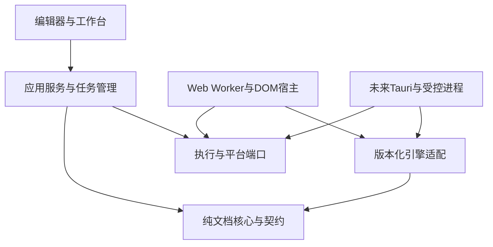
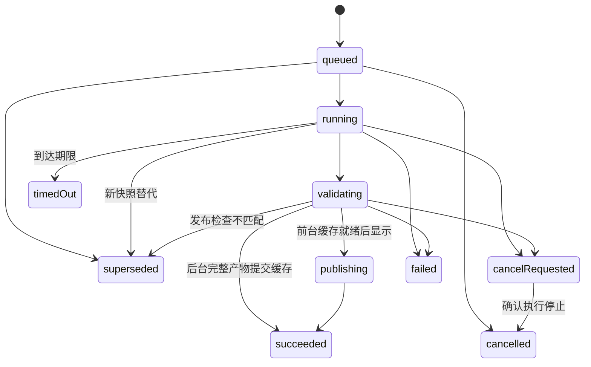

# MarkFlow 架构重构方案：文档任务管理与平台适配

文档编号：AR-01；草案版本：4；日期：2026-10-25（Asia/Shanghai）。状态：U0/U1策略与身份组件已实施，现有A2调度仍是旧模型；U2及后续调整未实施，A3及后续未实施。

设计冻结时的代码基线：typescript-strict / 75261ae1e532630a5a5859c397110f31698964af。基线完整审查已记录76项单元、22项Chromium通过；这是历史代码验证，不是本方案已经实现或通过验收。

配套文档：[技术栈评估](architecture-stack-assessment-2026-10-25.md)、[分步实施与验收](architecture-implementation-acceptance-2026-10-25.md)。既有依据：[总体设计](Markdown编辑器总体设计方案_V0.2.10.md)、[严格化审查](../reviews/typescript-strict-review-2026-10-25.md)、[审查证据](../acceptance/typescript-strict-review-evidence.json)。

## 1. 目标与范围

建立满足MarkFlow当前文档处理需求的健壮任务管理机制：Markdown解析、公式和图表生成、流式预览、A4分页、HTML/DOCX导出及浏览器打印准备。保持编辑器、多文档、三视图同步、显隐/宽度设置和本地优先能力。

现代化指标准能力、明确边界、可隔离执行、可维护发布；严格化同时包含编译期类型、运行时数据契约及生命周期约束。版本新旧不是独立替换依据。现有技术栈先作为功能基线，适配不足与库能力不足分别处理。

原方案编制与审查阶段只修改文档。用户后续已授权在architecture-refactor分支开始完整重构，此前已完成A0/A1和旧模型A2并按步骤本地提交；本次只修订前后台统一逻辑的文档；不推送、不合并、不移动标签、不升级MathJax、不替换Paged.js。[A0记录](../reviews/architecture-a0-baseline-2026-10-25.md)与[A1记录](../reviews/architecture-a1-implementation-2026-10-25.md)区分已执行与后续规划，不把A1的Worker导入烟测当作A3生产任务接入。

### 1.1 需求标识

| 标识 | 需求 |
| --- | --- |
| AR01 | 文档核心、任务管理、执行器、平台服务的依赖方向明确且可检查 |
| AR02 | 预览按当前文档与最新输入发布，旧任务不得覆盖新结果 |
| AR03 | 导出冻结输入、选项和资源授权，实际使用资源解析后固定，不混用后续编辑 |
| AR04 | 区分结果失效、取消请求、执行停止、超时及宿主故障 |
| AR05 | 任务所占资源和执行器租约可追踪，失败及重启后能够回收 |
| AR06 | Worker异常可终止/重建，后续任务可继续；DOM执行能力如实标识 |
| AR07 | Web开箱可用及普通HTTP路径保留，未来Tauri接入不改写领域规则 |
| AR08 | 类型严格、跨边界消息校验、可复现故障测试和验收证据 |
| AR09 | 仅在能力缺口和对照验证支持下替换技术栈，按步骤可回退 |
| AR10 | 多Tab单激活，文档会话独立；任务按文档归属、合并与取消 |
| AR11 | 切回Tab优先恢复有效预览产物，缓存有界且不丢失编辑状态 |
| AR12 | 预留版本化缓存与平台存储边界，持久化缓存后续接入，无需改写任务生命周期 |

### 1.2 规范效力与既有需求

这三份文件是现有总体设计和产品版本规划的架构补充，不取代产品范围。冲突按用户本会话最新确认、本补充的明确约束、既有方案依次解释；未明确调整的既有需求继续有效。总体设计中的技术目标不是当前实现证明。

| 既有事项 | 本轮解释与实施边界 |
| --- | --- |
| MathJax 4.x、CodeMirror及Shiki目标 | 当前代码仍以MathJax 3.2.2和textarea为迁移基线；用户明确暂不升级MathJax。本轮不替换编辑器，不取消高亮、输入法、撤销、查找替换等既定需求 |
| Worker、区块复用与M1–M4优化 | 既有Worker/基础复用需求仍需逐项追踪；本次先接解析Worker和整篇产物缓存，不以此声称完成Shiki/Graphviz Worker或公式级优化。原文中首版优化表述的差异按既有13.2节及最新确认区分，不能悄悄取消未完成的基线要求 |
| PWA/整应用离线 | 不在本轮新建PWA，但仍是既有1.0放行范围；静态资源齐备、普通HTTP可运行不等于PWA离线已验收 |
| 插件机制 | 保留构建时受信任语法/渲染/导出适配注册及按需加载；不开放任意用户任务/DAG或远程脚本。插件只产出候选产物和诊断，不拥有调度、发布或文件权限 |
| 输出与格式诊断 | MD/资源包、HTML、打印PDF、基础DOCX按原范围追踪；DOCX公式图片及明确降级保留，OMML/自动PDF/PPTX/EPUB仍后续 |
| HTML H0–H4与界面规范 | H0/H1按已选特性和五层能力验收，H2–H4仍后续；三视图不自动隐藏、设置弹窗和1024默认最大宽度不变 |

A0建立产品需求清单，逐项标注“当前已证实、此次实现、另行补齐、后续范围”。架构步骤结束不等于整个1.0范围已完成；缺失的基线功能须在0.9.x开发补齐，不能推入1.0验证阶段。

### 1.3 本轮规划不扩展的范围

不建设通用任务平台、分布式队列、远程任务服务、可编程工作流或任意作者JS插件。Redis、通用编排框架、持久化任务历史和跨机器调度不是前置依赖。PPT/EPUB、任意脚本HTML、H2–H4、PWA整应用离线、编辑器功能迁移仍分别管理。

本次采用多Tab单激活、前台/后台各一个Worker及各自串行队列，完整产物存入内存缓存，切换优先更替缓存指针。关闭后重开、应用重启后的预览缓存恢复及持久化缓存留待后续；它们不影响既有源文档持久化。跨修订公式缓存、区块缓存、视口优先和增量A4等细粒度优化继续保留为后续事项。合并未执行的过期预览、拒收迟到结果、限制队列属于本次正确性和资源边界，不以此宣称已实现高级性能优化。

## 2. 当前架构与实际问题

| 现状 | 代码依据 | 重构动机 |
| --- | --- | --- |
| 文档渲染、Mermaid和分页各维护Promise队列 | documentRenderer.ts、mermaidRender.ts、documentPaginator.ts | 缺少统一任务身份、资源账本和恢复状态 |
| schema导入渲染层，渲染策略导入时使用window | documentSchema.ts → htmlPolicy.ts → DOMPurify(window) | 纯数据校验无法直接在Worker中加载 |
| Markdown解析器调用公式缓存和DOM净化 | markdownParser.ts、mathRender.ts、htmlPolicy.ts | 解析、生成和浏览器宿主交织，难以独立执行 |
| 公式使用共享MathJax状态和会话级缓存 | mathRender.ts、mathJaxAdapter.ts | 当前文档串行规则必须保留，不能盲目并发化 |
| Mermaid需要DOM和计算样式 | mermaidRender.ts | 不是直接可迁入Worker的纯函数 |
| 分页直接访问主文档样式和隐藏DOM | documentPaginator.ts | 任务与界面共享故障/布局环境 |
| 超时只能限制等待，部分底层工作仍继续 | withDeadline及分页延迟清理 | 正确拒收不等于停止执行或释放租约 |
| 导出使用DOM测量、生成及交付 | htmlExporter.ts、docxExporter.ts、documentPrint.ts | 纯生成、布局和平台文件操作需要分离 |
| 持久化读取仍有强转/未完全校验路径 | storage.ts | strict不能替代运行时文档与迁移校验 |

这些是结构性改造依据，不推翻既有审查中的已验证修复。76/22的回归基线应继续保留。

## 3. 模块边界与依赖方向

采用同仓库模块化，初期不拆monorepo、独立npm包或服务进程。下列目录为目标组织建议，不代表当前存在。

| 目标模块 | 职责 | 允许依赖 | 禁止依赖 |
| --- | --- | --- | --- |
| core/document | 文档、主题、资源schema，版本与源范围，语义中间表示 | 纯TS、Zod、必要纯CSS值校验 | React、DOM、Window、Tauri、具体存储 |
| core/parse | Markdown→语义树，大纲、公式/图表节点提取与sourceRange | 文档契约、unified生态 | 公式生成器、DOMPurify、全局缓存、UI |
| core/output | 目标格式契约、适配诊断、纯序列化和输出计划 | 文档/产物契约 | 任意文件路径写入、UI状态、全局document |
| application/sessions | Tab顺序、唯一activeTabId、文档会话、编辑状态与预览引用 | 纯会话契约、任务/缓存端口 | 引擎实例、隐藏DOM、具体存储SDK |
| application/previewCache | 不可变产物索引、匹配、租用、预算与淘汰 | 文档/产物契约、注入时钟、缓存后端端口 | React、DOM节点、Worker、引擎全局状态 |
| application/tasks | 任务身份、输入快照、调度、状态转移、发布判定、资源租约 | 纯契约、执行/平台端口、注入时钟 | Worker构造、DOM、Bun/Tauri API及具体库内部状态 |
| engines | MathJax/Mermaid/分页/DOCX等版本化适配 | 纯契约、对应运行环境API | React状态、任务队列所有权、全局用户授权 |
| runtime/web | Worker、DOM宿主、消息通道及浏览器生命周期 | 任务端口、引擎适配、Web API | Tauri文件系统/进程接口 |
| platform/web | 浏览器存储、文件导入、下载、打印、资源读取 | 文档契约、Web API | 修改任务的领域判定规则 |
| platform/tauri（未来） | 本地文件/目录、权限令牌、原子提交、受控进程 | 同一平台端口、Tauri/Rust实现 | UI临时状态、任意无范围文件访问 |
| ui | 编辑交互、任务状态、三视图和结果展示 | 应用服务、只读快照、DOM视图 | 直接调用MathJax/Paged.js或绕过任务服务执行导出 |

组合入口负责注入适配器：UI → application → ports ← Web/Tauri具体实现。引擎只生成候选产物，不直接发布预览、写文件或触发下载。净化策略拆为纯规则/诊断契约与DOM净化实现，避免用模拟window掩盖依赖问题。

### 3.1 文档与产物

Markdown及文档记录仍是编辑权威来源；语义树、HTML/MathML/SVG、分页结果和DOCX均为派生产物。语义树保存nodeId、sourceRange和节点种类；渲染产物保留data-node-id及行范围映射，重构不得退回仅按全文百分比同步。

源文档模型与schema逐步形成单一可核对定义；跨Worker消息和持久化数据必须从unknown校验后进入领域。损坏文档保留原始备份或隔离记录并显示恢复入口，不静默覆盖成空文档。迁移不得修改用户未选择的其他文档。

应用UI继续允许OKLCH；文档输出默认HEX/RGB。流式HTML、分页样式与DOCX适配分别验证，不能以CSS.supports=true证明导出支持。

### 3.2 多Tab文档会话

支持多个打开的Tab，但同一时刻只有一个激活文档工作区；这与工作区内大纲/编辑器/HTML三个同时可见视图是两个维度。初期同一文档只建立一个Tab，重复打开聚焦已有Tab；tabId与documentId仍分别建模，为以后同文档多视图保留空间。

DocumentSession保存documentId、sessionGeneration、当前内容修订、未保存状态、编辑状态/撤销历史，以及光标、选区、语义滚动锚点、预览需求和产物引用。Tab记录引用会话，不复制第二份编辑权威数据。编辑器状态可由其专用适配器持有，不跨Worker序列化；替换编辑器不改变任务消息契约。

会话区分currentRevision、draftPersistedRevision、sourceSavedRevision及lastDownloadDispatchedRevision；草稿已持久化不等于源文件已写回，Web下载发起也不等于确认磁盘保存。未保存提示按相应目标修订比较，不能只有一个模糊dirty布尔值。

切换Tab不卸载文档会话、不清空撤销历史，也不取消该文档的保存。保存服务按documentId串行写入并核对保存修订；A的迟到保存回执不能把B或A的新修改标为已保存。关闭Tab确认保存时，等待所选修订真正成功，失败保留会话；“导出成功”不清除源文未保存标志。会话仅存缓存键/产物ID等可失效引用，不为所有后台Tab永久acquire租用，以免阻止LRU。关闭Tab先处理未保存修改和正在导出的任务，确认后提升会话代际、移除预览意图及租用；无其他消费者时释放产物引用。关闭后重开建立新代际，旧任务不可发布或写回新会话。关闭/切换不能隐式丢弃未保存内容，内存预算不能通过自动关闭脏文档达成。

### 3.3 完整产物缓存与有效性

缓存仅保存完成校验的完整产物，不保存中间数据、DOM树、Worker或引擎实例。完成表示完整产物校验和缓存指针提交均已完成；仅计算返回但仍在校验/写入的任务属于未完成。flow/A4分别记录完成状态，不能用一个模式的完成冒充另一个模式。初期仅内存缓存，源文档/撤销状态由会话持有，不受缓存淘汰影响。

统一缓存键为(documentId, previewKind, mdHash, renderConfigVersion)。mdHash使用Markdown原文UTF-8字节的SHA-256，不隐式归一化换行，不能直接沿用调用者随意填写的contentFingerprint。renderConfigVersion是单一渲染配置版本，主题、公式模式、引擎/净化策略、插件、会影响产物的字体/宽度/A4参数或资源上下文改变时统一推进；不要求调用方逐一匹配多组动态指纹。documentId隔离不同文档/工作区，不作跨文档去重。revision、activationEpoch和executorGeneration不是长期缓存命中条件。

MD散列和配置版本匹配且条目存在时，更替当前产物指针，重新挂载/测量并恢复语义位置，不重新解析/生成公式或图表。布局环境影响生成时推进同一配置版本；仅视图位置变化不使内容失效。源散列改变，未完成任务丢弃并使用新输入重算；已完成旧条目保留为完整旧快照，新产物完成后原子更新缓存指针，不能将旧条目冒充新版本。未命中、超限或被LRU淘汰时按同一路径重新生成。

资源访问仍经既有平台权限边界。预览只以单一配置版本表达资源上下文/显式授权变化，撤权时失效并撤下相关产物；不在每次切Tab时展开复杂授权/资源匹配。相同远端URL不保证字节永远相同，显式刷新/已知资源变化推进版本；不承诺仅凭MD散列检测远端变化。导出的冻结授权和资产校验保持独立要求。

每项产物一个字节所有者，视图只持引用；切换视图释放引用，不删除缓存。缓存不得保留隐藏宿主、监听器或Blob URL。保留条目/LRU/估算字节及活动/进行中总预算，脏文档不自动关闭；新双Worker及队列配额需先修订预算契约，不能把旧A0数值当作已适配。缓存恢复仍可能发生DOM挂载、资源就绪检查和布局，不承诺零浏览器排版。

### 3.4 统一Tab切换流程

切换流程对每次切换相同，不另设“再次切回”或“快速切换”分支。

| 时点/状态 | 必须执行的动作 |
| --- | --- |
| 切出：所需模式已完成 | 保留完整缓存，解除当前视图引用；不重新渲染 |
| 切出：所需模式未完成 | 立即作废本次任务并丢弃中间结果，停止路径由切换协调器调用；后台按最新散列/配置建立一个新待办，从头生成 |
| 切入：后台有该文档未完成任务 | 无论排队还是执行中均移除/作废，执行中先停止并清理；不把执行状态或中间数据迁移给前台 |
| 切入：存在有效完整缓存 | 直接访问缓存并更替当前指针；不为同一有效产物创建生成任务 |
| 切入：无有效缓存 | 按当前原文与配置版本建立前台新任务 |
| 后台空闲 | 从后台FIFO队列取一项执行 |
| 后台已有其他文档任务 | 保持该任务执行，新待办等待；切换不打断无关后台任务 |

后台待办按(documentId, sessionGeneration, previewKind)合并，每键一个最新待办，保留FIFO位置；流式/A4只是同一Worker内的串行任务，不并行运行。任务开始读取该文档最新原文与配置，核对散列；内容已变则更新待办。运行中的同文档内容/配置失效时丢弃并重排，不接续旧中间结果。队列容量与打开会话数量相关，不随点击次数无限增长，超限保留待更新标记并明确反馈。

后台新任务完整完成后可提交该文档缓存，不要求文档处于激活状态；后台不直接更新当前视图。作废前台/后台任务的迟到结果都不能复活或写缓存。只在队列入口、切换、完成提交和视图挂载边界核验文档归属、任务票据、散列和配置版本，不把切换策略分散到各生成步骤。停止未确认时不复用同一执行器；可协作停止或终止并重建由执行器适配器封装，UI只调用统一切换接口。

### 3.5 后续扩展与恢复边界

PreviewArtifactStore保留lookup、put、acquire/release、invalidate、evict及统计的异步端口，当前内存、后续持久化适配。完成提交校验任务票据、文档散列和配置版本，失效任务不得借异步put复活。展示恢复另核对当前Tab和恢复请求票据，失效引用立即释放。缓存提交与当前视图发布分开，不能用当前激活epoch拒绝有效后台缓存。

后续持久化内容含schemaVersion、统一缓存键、完整产物与必要资源元数据；未知版本/损坏条目视为未命中，不阻塞源保存。关闭重开、跨重启、细粒度公式/区块缓存仍后续实施。保持Web/Tauri端口，不增加SDK、磁盘缓存或通用任务平台。

## 4. 有限任务模型与执行器契约

### 4.1 只保留两类用户任务

| 用户任务 | 有限内部步骤 | 调度与发布 |
| --- | --- | --- |
| preview.flow / preview.a4 | 解析、生成、资源准备、净化、布局/分页 | 最新输入优先，只有当前期望快照可发布 |
| export.md / export.mdBundle / export.html / export.docx / export.print | 固定输入、解析资源、生成、布局、打包、交付 | 使用提交时快照；后续编辑不改变本次导出 |

MD纯文本导出可绕过渲染，资源包按源引用重写和冻结资产打包；它们仍使用同一身份、取消、资源与交付规则。源文件保存/自动保存属于文档服务，不伪装成预览任务，也不因导出而改变源关联。

内部步骤可以复用执行器，但不提供用户自定义DAG或任务插件注册表。按格式实现明确流水线即可。

### 4.2 输入、消息及能力

| 契约 | 必需内容 |
| --- | --- |
| TaskRequest | protocolVersion、taskId、documentId、revision、snapshotId、任务种类、输出配置、资源授权快照、来源会话身份；预览发布另带activationEpoch |
| 执行身份 | executorId、executorGeneration、attempt；宿主重建必须换generation |
| 消息 | 运行身份、任务身份、阶段及可选进度；start/progress/result/error/stop-ack使用判别联合 |
| 产物 | 内容及媒体类型、node/source映射、资源清单、诊断、引擎版本和布局配置 |
| ExecutorCapabilities | 支持的有限任务、是否需要DOM、取消方式、隔离等级、可否重建、并发上限 |
| 交付回执 | artifactId、交付类型及结果：下载dispatched、打印handedOff、桌面committed，以及failed/unknown；不能混用 |

跨边界消息用版本化schema校验；畸形/未知协议消息不进入UI或文件交付。引擎版本、文档修订、主题/宽度/输出配置修订和授权修订共同决定快照；只比较Markdown字符串或revision不够。

不跨线程传递DOM节点、React对象、函数和未授权文件句柄。传递文本、可序列化节点或二进制buffer；使用transfer时必须明确所有权转移，导出快照仍需保留的buffer不得被意外detach。

### 4.3 两条串行队列与执行边界

全应用固定一个前台Worker、一个后台Worker；两个Worker分别只允许一个活跃计算任务，各自串行，不按Tab创建Worker，也不为长队列增生实例。前台处理当前Tab需求；后台处理切出后未完成文档的重新生成。前后台拥有独立输入和引擎状态，不转移运行中任务，不共享可变中间数据；前后台可以同时工作，串行约束分别适用于每条队列。

任务角色foreground/background与执行环境worker/DOM是两个维度，不能把旧compute/dom槽位直接重命名为前台/后台。依赖DOM的MathJax/Mermaid/Paged.js步骤保留一个共享串行DOM执行通道，不虚称Web Worker具备DOM。等待DOM时相应渲染任务仍占自身逻辑任务槽；DOM不构成第三个Worker。DOM调度在当前步骤完成后优先已接受导出、再前台、再后台，不能并发访问共享引擎；前台优先不表示可抢占正在运行的DOM同步步骤。

导出仍最多一个已接受任务，切换不取消冻结导出，不借后台预览规则放宽权限或将预览缓存当作导出权威输入；不新增导出Worker。导出计算复用既有执行端口，具体接入留A5验证；已接受导出在下一可用共享步骤优先，正在执行步骤不抢占，平台交付等待不占生成槽。额外导出明确busy。队列等待、超时、停止确认和资源账本保留，测试聚焦切换/取消/完成边界而非任意抢占平台。

Worker停止并确认主宿主清理后才复用/重建，新代际ready另验。无法停止的DOM租约隔离且占预算，不无限新增宿主。重试仅限幂等步骤、最多一次新执行器尝试；文件交付和unknown不自动重试。双Worker的物理停止与资源峰值需要A3实测，不由纯队列测试代替。

## 5. 预览任务生命周期

图示是主要路径；任何非终态在期限到达或宿主故障时，监督器一旦能够执行就必须经统一状态规则结束。同线程DOM阻塞时不能保证定时器及时触发，因此Web的墙钟终止保证只覆盖独立受控计算任务，不扩展到任意DOM任务。同步发布是一次不可重入的“核验并替换”，不在检查与替换间异步yield。

1. 原文或渲染配置改变时更新mdHash/renderConfigVersion，对同文档同模式合并待办。
2. Tab切换仅经第3.4节统一流程；未完成即作废并丢弃，不迁移中间状态。排队取消立即移除，活跃任务停止/清理与队列释放由执行器统一处理。
3. 候选产物经完整校验后核对任务票据、文档散列和配置版本；作废/旧代际/已终态结果拒收。
4. 前台与后台都可提交完整缓存；后台不要求激活epoch匹配。前台当前视图发布额外检查当前Tab与恢复票据，同步替换指针及源映射。
5. 已完成任务切换只访问缓存；缓存失败/淘汰则记未命中，不使用半成品。失败旧快照可标记展示，但不能当作当前导出源。
6. 视图隐藏取消相应未完成需求，释放视图引用；不自动删除完整缓存。会话编辑/撤销/保存与可丢弃预览分离。

succeeded、failed、cancelled、superseded、timedOut均是结果终态，写入一次后不可被迟到回调改变。执行状态和资源释放另行记录，见第7节。

## 6. 导出任务生命周期

明确流水线阶段：accepted → snapshot → resources → generation → validation/layout → packaging → artifactReady → delivering → completed；这些是stage，不是第二套结果状态。导出结果采用queued/running/validating/cancelRequested及succeeded/failed/cancelled/timedOut终态，publishing仅表示预览同步发布；平台交付可异步等待，不套用预览“发布无yield”规则。交付回执unknown按failed终态和deliveryOutcome=unknown记录，成功仅表示达到平台可证明的交接/提交点。失败/取消走同一资源回收路径。

- 接受请求时复制文档、主题、选项、已有资产及授权范围。编辑继续、切换文档或改变设置不会改变该任务。
- 授权快照固定可访问范围，不能扩大实时权限：普通配置修改仅作用于新任务；显式撤权/目录令牌失效是独立事件，禁止尚未完成的读取和交付，受影响任务以权限失效失败并释放引用。已有不可逆交付不能撤回。
- 尚未读取的外部资源只能按冻结授权读取一次；解析后形成不可变的实际字节/哈希清单。URL快照不等于资源字节快照，后续步骤不得重新读取同URL替换内容。
- 系统字体无法取得字节时，记录字体声明及实际运行环境，不声称字体清单哈希可以保证跨设备相同页码。随包字体应固定版本、授权和哈希。
- 公式、图表、图片、字体及必要布局都就绪后，验证自包含要求和内容完整性，再打包；当前预览DOM不是导出权威输入。
- artifactReady表示产物已生成且校验通过，不代表用户已经保存文件。交付回执按平台区分。
- 浏览器下载发起只能显示“已生成并发起下载”，不能宣称磁盘已保存；浏览器打印只能确认交给打印流程，不能确认打印机或PDF保存成功。
- Tauri本地写入未来采用目标目录内临时文件与原子提交；只有提交成功才显示“已保存”。跨文件系统、覆盖策略或平台原子性不足必须明确失败/能力限制，不能静默退回破坏性写入。
- 交付锁在不可逆操作前核验取消、有效授权与目标能力，成功越过不可逆点才返回对应回执；调用抛错为failed，无法判断是否交接为unknown，均不得虚报成功。越过后不倒报cancelled；用户手动重试unknown交付前须了解重复输出可能，系统不自动重试。
- 排队、生成、取消宽限期分别受固定期限约束。平台保存对话框等待采用独立用户交互状态和可取消策略，不用生成超时中断已经提交的系统打印；外部打印结果不可观测，不让全局生成队列等到实体打印结束。活动导出槽在交接/失败后释放，交付资源按适配器可观测生命周期另行管理。

切换Tab不会取消已接受的导出，其进度与回执始终标明来源文档；关闭Tab时由用户明确选择继续导出或在可取消点前取消。导出保留自己的输入/资源引用，不依赖Tab或缓存条目存活；当前阶段不直接把预览缓存当作导出输入。预览任务替代不会取消已接受的导出；导出也不得把冻结文档状态反写当前编辑器。错误与警告沿用已有内容适配契约，未知公式或内容丢失不能作为成功导出。

## 7. 取消、超时、执行器失效

### 7.1 结果状态与执行器租约分开

| 事件 | 任务结果 | 执行器/资源 |
| --- | --- | --- |
| 未开始时取消 | cancelled | 移出队列，释放输入引用 |
| 新修订替代 | superseded，不再发布 | 继续请求停止；未确认停止前保留租约 |
| 运行时点击取消 | cancelRequested，等待确认 | 协作停止或终止执行器；确认后才cancelled |
| 到达超时 | timedOut，拒收结果 | 启动停止/隔离；不能因Promise拒绝立即复用宿主 |
| Worker已终止/进程已退出 | 保持已确定的终态 | 主监督器回收资源，重建后换generation |
| DOM工作未能停止 | timedOut或superseded；提示恢复中/需重载 | 租约quarantined；不得继续在该宿主执行新任务 |
| 渲染与清理同时失败 | failed并保留两个原因 | 资源账本继续追踪，宿主不能误报healthy |

执行器状态采用idle、busy、quarantined、restarting、disposed。已发布后才发现的清理/缓存故障单独记录运行健康与资源诊断，不把succeeded追溯改为failed；发布前发现致命清理问题则不发布。结果终态不等于执行器已idle；UI的“结果已失效/超时”与“后台执行已停止”必须区分。

### 7.2 取消方式

| 方式 | 作用 | 不能承诺的内容 |
| --- | --- | --- |
| 结果失效标记 | 防止旧结果发布或写入 | 不停止CPU/DOM任务 |
| AbortSignal/停止消息 | 协作取消资源读取和有检查点的代码 | 无法抢占任意同步循环 |
| Worker.terminate | 从外部终止该Worker并重建 | 不执行Worker内部finally；不自动回收主宿主资源 |
| 受控进程终止（未来） | 从外部结束本应用独占的进程树 | 不能杀共享系统WebView或其他应用进程 |

预览结果状态统一为queued、running、validating、publishing、cancelRequested及succeeded/failed/cancelled/superseded/timedOut；导出使用其中适用状态及第6节stage，不使用superseded来取消冻结输入，也不因切换Tab改变终态。取消请求返回accepted/tooLate/alreadyTerminal，停止确认属于独立StopReceipt；确认停止前不得宣称cancelled。取消宽限期到达而无法确认时转timedOut并隔离，避免永久停留cancelRequested。

取消API提供可核对的停止状态，而不是只返回AbortController。资源清理的控制权放在任务监督器，不能依赖被终止任务自行汇报完成。

### 7.3 期限与监控

作为迁移起始基线保留已有阶段期限：资源读取15秒、启动/转换/模块加载及一般就绪阶段20秒、单次分页60秒。不得在每条progress消息后无限续期；每个用户任务还需固定总期限和输入/阶段数量上限。

总期限与最大文档规模在A0基准中确定，并在A2启用前冻结到可测试配置；冻结前不得宣称整体任务等待有界。现有单图10MB、总图25MB、128项资产及单文件HTML50MB上限先保留。

监督器使用单调时钟与固定deadline；下列前台响应目标以主监督器事件循环可调度为条件，不覆盖同线程DOM阻塞或系统挂起。排队期限、执行期限、取消宽限期分开。前台以停止触发后1秒内调用外部终止并使旧代际失效为目标；新Worker达到ready的期限由A0按实际启动成本另定，不能把引擎冷启动也强行记为1秒。Worker.terminate本身没有来自被终止线程的stop-ack，以宿主终止记录和新代际ready分别确认。不将后台标签页定时器节流误判为崩溃。心跳仅用于辅助诊断，不能证明同线程DOM任务可抢占。

Web Worker超时监控由外部主宿主执行；同事件循环DOM死循环会阻塞该主宿主，Promise超时和iframe销毁代码也可能无法运行。强DOM停止能力必须由独立执行环境和外部监督机制提供，不能只加一层Promise。

## 8. 资源归属

| 资源 | 所有者 | 释放/移交条件 |
| --- | --- | --- |
| 文档会话与编辑状态 | 会话管理器/编辑器适配器 | 切换保留；关闭前处理未保存内容，不受缓存LRU控制 |
| 不可变预览产物 | 预览缓存管理器 | 引用计数与LRU共同管理；入库为显式所有权移交 |
| 视图挂载与恢复测量 | 当前视图 | 切换/卸载释放DOM、URL和监听器，不删除缓存字节 |
| 文档记录与持久化备份 | 文档存储服务 | 显式保存/迁移/删除；任务取消不能删除源文档 |
| 输入快照、冻结配置与授权快照 | 用户任务 | 终态且无执行/交付引用后释放 |
| 实际资产字节与清单 | 任务资源会话，成功缓存后显式移交产物管理器 | 所有下游消费者完成或确认停止后释放；入库资产与产物共同计费 |
| Worker/DOM宿主/未来进程 | 执行器管理器 | 任务结束且清理成功；异常则隔离并重建 |
| 隐藏DOM、样式、布局临时节点 | 对应DOM执行器租约 | 底层执行停止后清理；不得提前移除活动宿主 |
| Blob URL、监听器、计时器、消息端口 | 创建时登记的资源会话 | UI/交付引用归零后显式释放 |
| 已展示产物的租用引用 | 预览视图 | 替换/销毁释放租用；产物字节仍由缓存/产物管理器持有，不形成第二所有者 |
| 下载Blob/打印宿主 | 交付适配器 | 浏览器交付/打印生命周期结束后释放，不随生成任务过早释放 |
| 临时输出文件/目标提交锁（未来） | Tauri文件交付适配器 | 提交或回滚完成；崩溃恢复扫描仅清理应用登记的临时文件 |

资源登记按类别包含任务角色foreground/background、taskId、snapshotId、executorGeneration，以及适用的documentId、sessionGeneration、artifactId和租用者。缓存完成所有权移交后不依赖原执行器继续存活；不缓存的过大产物也由产物管理器以仅活动租用方式持有，卸载后立即释放，仍计入总资源预算。每项资源一个所有者；转移时明确释放责任。清理幂等、逐项尝试并聚合错误；清理失败留可观察记录，不伪报全部释放。

不把“先释放队列再等后台退出”作为恢复方式。新任务只能使用健康执行器；隔离执行器仍占资源预算，不能无限新建来绕过卡死。

## 9. Web与未来Tauri边界

| 能力 | Web首阶段 | 未来Tauri |
| --- | --- | --- |
| 编辑/三视图/语义同步 | 保持现有功能与映射 | 复用前端和文档核心 |
| 纯计算 | Dedicated Worker，postMessage及可终止生命周期 | 可复用Worker或增加受控计算进程 |
| DOM渲染/分页 | 独立文档/iframe隔离样式，明确有限恢复能力 | 评估可监督的独立渲染进程；不能假定多WebView就已隔离 |
| 本地文件/目录 | 文件选择、导入及下载；不要求File System Access API | 用户授权目录/文件令牌；读写、监听及原子交付 |
| 存储 | 校验后的IndexedDB与已说明的回退 | 接入本地存储端口及迁移；不硬编码当前浏览器键值结构 |
| 打印/PDF | 浏览器打印交付，不确认实体结果 | 可接系统打印；如需固定PDF另评估受控浏览器渲染 |
| 普通HTTP | 保留核心路径，不以SAB/跨源隔离为前置 | 使用受控本地协议和权限配置 |
| 运行资源发布 | 编译资源、引擎/WASM及批准字体随静态包提供 | 运行时/sidecar及必要资源随安装包提供 |

新增端口包括TaskExecutor、DocumentRepository、AssetResolver、FileDelivery、PrintDelivery、PlatformCapabilities，以及上述PreviewArtifactStore（当前内存、后续持久化适配）。任务管理不拿任意本地路径，只使用平台发放的有范围令牌；由适配器验证授权修订和资源实际来源。

纯Bun/Node sidecar不具备真实DOM排版。若未来要求“分页任意卡死但编辑器始终响应，且可硬终止”，需独立渲染进程及外部监督器；评估随包浏览器时同时核算安装体积、更新和字体一致性。不把首启联网下载必需运行时当作开箱可用。

Tauri层初期只预留接口和能力等级，不增加SDK、Rust工程或sidecar。Web不承诺对任意DOM死循环的硬取消；如该保证被定义为Web发布硬门槛，应先调整交付范围或提前验证桌面方案，而不能隐藏限制。

## 10. 必须维持的产品行为

- 多Tab单激活；切换保留独立编辑状态、位置及有效预览缓存，任务按文档归属；后台导出不被切换取消。持久化缓存及关闭/重启后缓存恢复仍为后续事项。

- 三视图由用户逐步显隐，最后一个不可隐藏；开启视图同时显示，不按断点自动隐藏；工作台内横向滚动，编辑/HTML默认最大宽度1024且可配置，设置默认隐藏并由弹窗打开。
- 大纲选择定位编辑器对应章节顶部，编辑器/HTML双向语义同步；任务结果更替后映射和当前章节保持一致，不用过期布局驱动当前视窗。
- 公式继续接受LaTeX数学语法，MathML/SVG输出和未知命令失败策略保留；不隐式联网加载未批准扩展。
- HTML单文件离线与源载荷往返、图表静态化、DOCX适配诊断、A4内容完整性均继续验收。
- 核心编辑、预览和导出不要求账号或后端，不自动上传正文；必需引擎资源随包交付。用户批准的外部内容资源读取与上传正文是不同授权，不相互推导。
- 持久化保存作为独立文档服务，不因预览取消而丢失编辑；重构不把自动保存放到可任意丢弃的预览队列。

## 11. 待决策事项

| 决策 | 当前建议 | 决策门槛 |
| --- | --- | --- |
| D01 Web可靠性边界 | Worker可硬取消；DOM有限恢复如实呈现 | 若要求所有排版均可硬取消，先调整交付形态 |
| D02 分页引擎 | Paged.js暂作基线，与原生打印/Vivliostyle做对照 | 兼容、恢复、发布及迁移收益通过实测 |
| D03 MathJax升级/Worker | 保留3.2.2及当前适配；另行PoC | 公式/宏/字体/离线/导出回归及执行边界明确 |
| D04 编辑器 | 现有textarea基线不在本轮被动替换 | CodeMirror等需与既定高亮方案对照并单独决定 |
| D05 强DOM隔离 | 为未来Tauri预留，不预选渲染进程方案 | 进程树终止、系统兼容与随包体积实测 |

技术决定按配套评估矩阵执行。功能与重构开发留在0.9.x阶段；0.9→1.0仍只做审查、验证及必要修复，不能借验证阶段增加新架构功能。

## 12. 一手参考与验证性质

- [Worker终止语义](https://developer.mozilla.org/en-US/docs/Web/API/Worker/terminate)：外部终止不会等待任务自行清理。
- [Worker能力范围](https://developer.mozilla.org/en-US/docs/Web/API/Web_Workers_API/Using_web_workers)：与DOM宿主分工。
- [Chromium进程模型](https://chromium.googlesource.com/chromium/src.git/+/HEAD/docs/process_model_and_site_isolation.md)：页面/iframe不是应用可保证的一任务一独立进程。
- [Tauri随包外部程序](https://v2.tauri.app/develop/sidecar/)：未来受控进程发布依据，不表示当前已接入。

本文件是设计与讨论依据。文档检查只能证明结构/链接/约束一致，不能证明任务机制已实现；实现证据必须按配套阶段另行生成。本轮完整审查的问题与修正见[审查记录](architecture-implementation-acceptance-2026-10-25.md#9-本轮完整文档审查记录)。

## A0/A1完整代码审查补充（2026-10-25，历史记录）

[审查修复记录](../reviews/architecture-a0-a1-review-2026-10-25.md)与[独立证据](../acceptance/architecture-a0-a1-review-evidence.json)覆盖AC01/AC02：纯层和平台边界、四环境受管文件类型覆盖、开发及构建后真实Worker、后端固定、部分坏数据继续读取、恢复索引逐项校验、同修订冲突与应用失败反馈。未知版本不自动迁移；原件保留，恢复下载对非JSON类型仅供检查。冻结A0/A1证据不改写，复测有独立输出与比较命令。

A1的Worker测试为解析/schema构建兼容性证明，不是A3生产任务调度、终止与重建证明。Web存储端口不引入Tauri SDK；A2任务生命周期/超时/资源账本、A4独立Tab会话和产物缓存、A5其余平台端口均保持后续规划，未因本轮通过而视为完成。MathJax和Paged.js不变，未声明远端CI、其他浏览器、Word/WPS或实体打印验收。

## A2 旧模型实施记录（2026-10-25，不代表本次调整已实现）

此前已实施旧模型纯任务治理组件，见[实施记录](../reviews/architecture-a2-implementation-2026-10-25.md)。上一轮综合证据尚未独立归档，不能引用不存在的验收文件。位于src/application/tasks，职责分别为有限schema/身份、状态机、A0预算、资源账本、会话/恢复身份、合并队列、固定期限、执行器租约和组合监督。没有引入通用任务框架或新依赖。

旧模型实际规则（历史，不用于本次规划）：compute/DOM各一个通道；只有激活文档flow/A4最新待办可运行；导出最多一个已接受任务且下一可用通道优先。取消确认与任务终态/租约分开；未停止、清理失败或校验仍挂起时不复用通道。异步校验后重核完整身份/授权，同步发布不可重入。撤权可撤下已发布视图，撤下失败保留资源及健康诊断，不能改写既定成功终态。导出产物就绪不等于交付，unknown不能显示成功或自动重试。

A2仅提供会话代际和异步恢复令牌，不实现编辑器Tab会话、缓存后端、真实资源授权读取或交付操作。实际候选产物净化/完整性验证、视图发布/撤下由受信任适配器注入；旧渲染/导出队列仍保持原状。A3接真实Worker及ready/terminate，A4逐个引擎与UI接入，A5真实交付；不得把A2测试执行器结果视为这些后续阶段已通过。历史实施附记按当时状态保留；新版以AR-01统一切换规则及本次调整计划为准，不能由旧实现证据推定新版已完成。

## 13. 本次调整状态

前后台统一逻辑为当前设计，以第3.3—3.5、第4.3及第5节为准；文末旧模型实施记录仅反映现有A2代码。当前A2差异与小步调整见[差异及调整计划](../reviews/architecture-a2-dual-worker-adjustment-2026-10-25.md)。本轮仅修改文档，不修改代码/预算JSON，不提交、不推送。MathJax/Paged.js保持原版本。

### U0/U1契约实施进度（2026-10-25）

U0新版策略及U1前后台角色/MD散列/配置版本/缓存键组件已验证并按步骤本地提交，见[调整执行记录](../reviews/architecture-a2-dual-worker-adjustment-2026-10-25.md)和[独立证据](../acceptance/architecture-u0-u1-evidence.json)。A0预算JSON保持冻结，新策略独立保存；旧运行票据和调度守卫保留。U2队列、U3统一切换、U4缓存提交及后续真实Worker/UI仍未接入，不能宣称双Worker已经运行。
