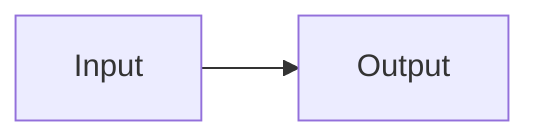
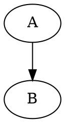

# Architecture large

<div class="mf-columns"><section>中文卡片</section><section>Responsive</section></div>

## Section 0

中文与 Latin、emoji 🧪、**strong** 和 [anchor](#end)。 可靠的文档结构。 可靠的文档结构。 可靠的文档结构。 可靠的文档结构。 可靠的文档结构。 可靠的文档结构。 

- outer
  - nested
- [x] done

$E=mc^2$ 与 $\frac{a}{b}$。

| key | value |
| --- | --- |
| 0 | TABLE_0_0 |
| 1 | TABLE_0_1 |
| 2 | TABLE_0_2 |
| 3 | TABLE_0_3 |
| 4 | TABLE_0_4 |
| 5 | TABLE_0_5 |

```typescript
const value0 = "CODE_0_0";
const value1 = "CODE_0_1";
const value2 = "CODE_0_2";
const value3 = "CODE_0_3";
const value4 = "CODE_0_4";
const value5 = "CODE_0_5";
```

## Section 1

中文与 Latin、emoji 🧪、**strong** 和 [anchor](#end)。 可靠的文档结构。 可靠的文档结构。 可靠的文档结构。 可靠的文档结构。 可靠的文档结构。 可靠的文档结构。 

- outer
  - nested
- [x] done

$E=mc^2$ 与 $\frac{a}{b}$。

| key | value |
| --- | --- |
| 0 | TABLE_1_0 |
| 1 | TABLE_1_1 |
| 2 | TABLE_1_2 |
| 3 | TABLE_1_3 |
| 4 | TABLE_1_4 |
| 5 | TABLE_1_5 |

```typescript
const value0 = "CODE_1_0";
const value1 = "CODE_1_1";
const value2 = "CODE_1_2";
const value3 = "CODE_1_3";
const value4 = "CODE_1_4";
const value5 = "CODE_1_5";
```

## Section 2

中文与 Latin、emoji 🧪、**strong** 和 [anchor](#end)。 可靠的文档结构。 可靠的文档结构。 可靠的文档结构。 可靠的文档结构。 可靠的文档结构。 可靠的文档结构。 

- outer
  - nested
- [x] done

$E=mc^2$ 与 $\frac{a}{b}$。

| key | value |
| --- | --- |
| 0 | TABLE_2_0 |
| 1 | TABLE_2_1 |
| 2 | TABLE_2_2 |
| 3 | TABLE_2_3 |
| 4 | TABLE_2_4 |
| 5 | TABLE_2_5 |

```typescript
const value0 = "CODE_2_0";
const value1 = "CODE_2_1";
const value2 = "CODE_2_2";
const value3 = "CODE_2_3";
const value4 = "CODE_2_4";
const value5 = "CODE_2_5";
```

## Section 3

中文与 Latin、emoji 🧪、**strong** 和 [anchor](#end)。 可靠的文档结构。 可靠的文档结构。 可靠的文档结构。 可靠的文档结构。 可靠的文档结构。 可靠的文档结构。 

- outer
  - nested
- [x] done

$E=mc^2$ 与 $\frac{a}{b}$。

| key | value |
| --- | --- |
| 0 | TABLE_3_0 |
| 1 | TABLE_3_1 |
| 2 | TABLE_3_2 |
| 3 | TABLE_3_3 |
| 4 | TABLE_3_4 |
| 5 | TABLE_3_5 |

```typescript
const value0 = "CODE_3_0";
const value1 = "CODE_3_1";
const value2 = "CODE_3_2";
const value3 = "CODE_3_3";
const value4 = "CODE_3_4";
const value5 = "CODE_3_5";
```

## Section 4

中文与 Latin、emoji 🧪、**strong** 和 [anchor](#end)。 可靠的文档结构。 可靠的文档结构。 可靠的文档结构。 可靠的文档结构。 可靠的文档结构。 可靠的文档结构。 

- outer
  - nested
- [x] done

$E=mc^2$ 与 $\frac{a}{b}$。

| key | value |
| --- | --- |
| 0 | TABLE_4_0 |
| 1 | TABLE_4_1 |
| 2 | TABLE_4_2 |
| 3 | TABLE_4_3 |
| 4 | TABLE_4_4 |
| 5 | TABLE_4_5 |

```typescript
const value0 = "CODE_4_0";
const value1 = "CODE_4_1";
const value2 = "CODE_4_2";
const value3 = "CODE_4_3";
const value4 = "CODE_4_4";
const value5 = "CODE_4_5";
```

## Section 5

中文与 Latin、emoji 🧪、**strong** 和 [anchor](#end)。 可靠的文档结构。 可靠的文档结构。 可靠的文档结构。 可靠的文档结构。 可靠的文档结构。 可靠的文档结构。 

- outer
  - nested
- [x] done

$E=mc^2$ 与 $\frac{a}{b}$。

| key | value |
| --- | --- |
| 0 | TABLE_5_0 |
| 1 | TABLE_5_1 |
| 2 | TABLE_5_2 |
| 3 | TABLE_5_3 |
| 4 | TABLE_5_4 |
| 5 | TABLE_5_5 |

```typescript
const value0 = "CODE_5_0";
const value1 = "CODE_5_1";
const value2 = "CODE_5_2";
const value3 = "CODE_5_3";
const value4 = "CODE_5_4";
const value5 = "CODE_5_5";
```

## Section 6

中文与 Latin、emoji 🧪、**strong** 和 [anchor](#end)。 可靠的文档结构。 可靠的文档结构。 可靠的文档结构。 可靠的文档结构。 可靠的文档结构。 可靠的文档结构。 

- outer
  - nested
- [x] done

$E=mc^2$ 与 $\frac{a}{b}$。

| key | value |
| --- | --- |
| 0 | TABLE_6_0 |
| 1 | TABLE_6_1 |
| 2 | TABLE_6_2 |
| 3 | TABLE_6_3 |
| 4 | TABLE_6_4 |
| 5 | TABLE_6_5 |

```typescript
const value0 = "CODE_6_0";
const value1 = "CODE_6_1";
const value2 = "CODE_6_2";
const value3 = "CODE_6_3";
const value4 = "CODE_6_4";
const value5 = "CODE_6_5";
```

## Section 7

中文与 Latin、emoji 🧪、**strong** 和 [anchor](#end)。 可靠的文档结构。 可靠的文档结构。 可靠的文档结构。 可靠的文档结构。 可靠的文档结构。 可靠的文档结构。 

- outer
  - nested
- [x] done

$E=mc^2$ 与 $\frac{a}{b}$。

| key | value |
| --- | --- |
| 0 | TABLE_7_0 |
| 1 | TABLE_7_1 |
| 2 | TABLE_7_2 |
| 3 | TABLE_7_3 |
| 4 | TABLE_7_4 |
| 5 | TABLE_7_5 |

```typescript
const value0 = "CODE_7_0";
const value1 = "CODE_7_1";
const value2 = "CODE_7_2";
const value3 = "CODE_7_3";
const value4 = "CODE_7_4";
const value5 = "CODE_7_5";
```

## Section 8

中文与 Latin、emoji 🧪、**strong** 和 [anchor](#end)。 可靠的文档结构。 可靠的文档结构。 可靠的文档结构。 可靠的文档结构。 可靠的文档结构。 可靠的文档结构。 

- outer
  - nested
- [x] done

$E=mc^2$ 与 $\frac{a}{b}$。

| key | value |
| --- | --- |
| 0 | TABLE_8_0 |
| 1 | TABLE_8_1 |
| 2 | TABLE_8_2 |
| 3 | TABLE_8_3 |
| 4 | TABLE_8_4 |
| 5 | TABLE_8_5 |

```typescript
const value0 = "CODE_8_0";
const value1 = "CODE_8_1";
const value2 = "CODE_8_2";
const value3 = "CODE_8_3";
const value4 = "CODE_8_4";
const value5 = "CODE_8_5";
```

## Section 9

中文与 Latin、emoji 🧪、**strong** 和 [anchor](#end)。 可靠的文档结构。 可靠的文档结构。 可靠的文档结构。 可靠的文档结构。 可靠的文档结构。 可靠的文档结构。 

- outer
  - nested
- [x] done

$E=mc^2$ 与 $\frac{a}{b}$。

| key | value |
| --- | --- |
| 0 | TABLE_9_0 |
| 1 | TABLE_9_1 |
| 2 | TABLE_9_2 |
| 3 | TABLE_9_3 |
| 4 | TABLE_9_4 |
| 5 | TABLE_9_5 |

```typescript
const value0 = "CODE_9_0";
const value1 = "CODE_9_1";
const value2 = "CODE_9_2";
const value3 = "CODE_9_3";
const value4 = "CODE_9_4";
const value5 = "CODE_9_5";
```

## Section 10

中文与 Latin、emoji 🧪、**strong** 和 [anchor](#end)。 可靠的文档结构。 可靠的文档结构。 可靠的文档结构。 可靠的文档结构。 可靠的文档结构。 可靠的文档结构。 

- outer
  - nested
- [x] done

$E=mc^2$ 与 $\frac{a}{b}$。

| key | value |
| --- | --- |
| 0 | TABLE_10_0 |
| 1 | TABLE_10_1 |
| 2 | TABLE_10_2 |
| 3 | TABLE_10_3 |
| 4 | TABLE_10_4 |
| 5 | TABLE_10_5 |

```typescript
const value0 = "CODE_10_0";
const value1 = "CODE_10_1";
const value2 = "CODE_10_2";
const value3 = "CODE_10_3";
const value4 = "CODE_10_4";
const value5 = "CODE_10_5";
```

## Section 11

中文与 Latin、emoji 🧪、**strong** 和 [anchor](#end)。 可靠的文档结构。 可靠的文档结构。 可靠的文档结构。 可靠的文档结构。 可靠的文档结构。 可靠的文档结构。 

- outer
  - nested
- [x] done

$E=mc^2$ 与 $\frac{a}{b}$。

| key | value |
| --- | --- |
| 0 | TABLE_11_0 |
| 1 | TABLE_11_1 |
| 2 | TABLE_11_2 |
| 3 | TABLE_11_3 |
| 4 | TABLE_11_4 |
| 5 | TABLE_11_5 |

```typescript
const value0 = "CODE_11_0";
const value1 = "CODE_11_1";
const value2 = "CODE_11_2";
const value3 = "CODE_11_3";
const value4 = "CODE_11_4";
const value5 = "CODE_11_5";
```

## Section 12

中文与 Latin、emoji 🧪、**strong** 和 [anchor](#end)。 可靠的文档结构。 可靠的文档结构。 可靠的文档结构。 可靠的文档结构。 可靠的文档结构。 可靠的文档结构。 

- outer
  - nested
- [x] done

$E=mc^2$ 与 $\frac{a}{b}$。

| key | value |
| --- | --- |
| 0 | TABLE_12_0 |
| 1 | TABLE_12_1 |
| 2 | TABLE_12_2 |
| 3 | TABLE_12_3 |
| 4 | TABLE_12_4 |
| 5 | TABLE_12_5 |

```typescript
const value0 = "CODE_12_0";
const value1 = "CODE_12_1";
const value2 = "CODE_12_2";
const value3 = "CODE_12_3";
const value4 = "CODE_12_4";
const value5 = "CODE_12_5";
```

## Section 13

中文与 Latin、emoji 🧪、**strong** 和 [anchor](#end)。 可靠的文档结构。 可靠的文档结构。 可靠的文档结构。 可靠的文档结构。 可靠的文档结构。 可靠的文档结构。 

- outer
  - nested
- [x] done

$E=mc^2$ 与 $\frac{a}{b}$。

| key | value |
| --- | --- |
| 0 | TABLE_13_0 |
| 1 | TABLE_13_1 |
| 2 | TABLE_13_2 |
| 3 | TABLE_13_3 |
| 4 | TABLE_13_4 |
| 5 | TABLE_13_5 |

```typescript
const value0 = "CODE_13_0";
const value1 = "CODE_13_1";
const value2 = "CODE_13_2";
const value3 = "CODE_13_3";
const value4 = "CODE_13_4";
const value5 = "CODE_13_5";
```

## Section 14

中文与 Latin、emoji 🧪、**strong** 和 [anchor](#end)。 可靠的文档结构。 可靠的文档结构。 可靠的文档结构。 可靠的文档结构。 可靠的文档结构。 可靠的文档结构。 

- outer
  - nested
- [x] done

$E=mc^2$ 与 $\frac{a}{b}$。

| key | value |
| --- | --- |
| 0 | TABLE_14_0 |
| 1 | TABLE_14_1 |
| 2 | TABLE_14_2 |
| 3 | TABLE_14_3 |
| 4 | TABLE_14_4 |
| 5 | TABLE_14_5 |

```typescript
const value0 = "CODE_14_0";
const value1 = "CODE_14_1";
const value2 = "CODE_14_2";
const value3 = "CODE_14_3";
const value4 = "CODE_14_4";
const value5 = "CODE_14_5";
```

## Section 15

中文与 Latin、emoji 🧪、**strong** 和 [anchor](#end)。 可靠的文档结构。 可靠的文档结构。 可靠的文档结构。 可靠的文档结构。 可靠的文档结构。 可靠的文档结构。 

- outer
  - nested
- [x] done

$E=mc^2$ 与 $\frac{a}{b}$。

| key | value |
| --- | --- |
| 0 | TABLE_15_0 |
| 1 | TABLE_15_1 |
| 2 | TABLE_15_2 |
| 3 | TABLE_15_3 |
| 4 | TABLE_15_4 |
| 5 | TABLE_15_5 |

```typescript
const value0 = "CODE_15_0";
const value1 = "CODE_15_1";
const value2 = "CODE_15_2";
const value3 = "CODE_15_3";
const value4 = "CODE_15_4";
const value5 = "CODE_15_5";
```

## Section 16

中文与 Latin、emoji 🧪、**strong** 和 [anchor](#end)。 可靠的文档结构。 可靠的文档结构。 可靠的文档结构。 可靠的文档结构。 可靠的文档结构。 可靠的文档结构。 

- outer
  - nested
- [x] done

$E=mc^2$ 与 $\frac{a}{b}$。

| key | value |
| --- | --- |
| 0 | TABLE_16_0 |
| 1 | TABLE_16_1 |
| 2 | TABLE_16_2 |
| 3 | TABLE_16_3 |
| 4 | TABLE_16_4 |
| 5 | TABLE_16_5 |

```typescript
const value0 = "CODE_16_0";
const value1 = "CODE_16_1";
const value2 = "CODE_16_2";
const value3 = "CODE_16_3";
const value4 = "CODE_16_4";
const value5 = "CODE_16_5";
```

## Section 17

中文与 Latin、emoji 🧪、**strong** 和 [anchor](#end)。 可靠的文档结构。 可靠的文档结构。 可靠的文档结构。 可靠的文档结构。 可靠的文档结构。 可靠的文档结构。 

- outer
  - nested
- [x] done

$E=mc^2$ 与 $\frac{a}{b}$。

| key | value |
| --- | --- |
| 0 | TABLE_17_0 |
| 1 | TABLE_17_1 |
| 2 | TABLE_17_2 |
| 3 | TABLE_17_3 |
| 4 | TABLE_17_4 |
| 5 | TABLE_17_5 |

```typescript
const value0 = "CODE_17_0";
const value1 = "CODE_17_1";
const value2 = "CODE_17_2";
const value3 = "CODE_17_3";
const value4 = "CODE_17_4";
const value5 = "CODE_17_5";
```

## Section 18

中文与 Latin、emoji 🧪、**strong** 和 [anchor](#end)。 可靠的文档结构。 可靠的文档结构。 可靠的文档结构。 可靠的文档结构。 可靠的文档结构。 可靠的文档结构。 

- outer
  - nested
- [x] done

$E=mc^2$ 与 $\frac{a}{b}$。

| key | value |
| --- | --- |
| 0 | TABLE_18_0 |
| 1 | TABLE_18_1 |
| 2 | TABLE_18_2 |
| 3 | TABLE_18_3 |
| 4 | TABLE_18_4 |
| 5 | TABLE_18_5 |

```typescript
const value0 = "CODE_18_0";
const value1 = "CODE_18_1";
const value2 = "CODE_18_2";
const value3 = "CODE_18_3";
const value4 = "CODE_18_4";
const value5 = "CODE_18_5";
```

## Section 19

中文与 Latin、emoji 🧪、**strong** 和 [anchor](#end)。 可靠的文档结构。 可靠的文档结构。 可靠的文档结构。 可靠的文档结构。 可靠的文档结构。 可靠的文档结构。 

- outer
  - nested
- [x] done

$E=mc^2$ 与 $\frac{a}{b}$。

| key | value |
| --- | --- |
| 0 | TABLE_19_0 |
| 1 | TABLE_19_1 |
| 2 | TABLE_19_2 |
| 3 | TABLE_19_3 |
| 4 | TABLE_19_4 |
| 5 | TABLE_19_5 |

```typescript
const value0 = "CODE_19_0";
const value1 = "CODE_19_1";
const value2 = "CODE_19_2";
const value3 = "CODE_19_3";
const value4 = "CODE_19_4";
const value5 = "CODE_19_5";
```

## Section 20

中文与 Latin、emoji 🧪、**strong** 和 [anchor](#end)。 可靠的文档结构。 可靠的文档结构。 可靠的文档结构。 可靠的文档结构。 可靠的文档结构。 可靠的文档结构。 

- outer
  - nested
- [x] done

$E=mc^2$ 与 $\frac{a}{b}$。

| key | value |
| --- | --- |
| 0 | TABLE_20_0 |
| 1 | TABLE_20_1 |
| 2 | TABLE_20_2 |
| 3 | TABLE_20_3 |
| 4 | TABLE_20_4 |
| 5 | TABLE_20_5 |

```typescript
const value0 = "CODE_20_0";
const value1 = "CODE_20_1";
const value2 = "CODE_20_2";
const value3 = "CODE_20_3";
const value4 = "CODE_20_4";
const value5 = "CODE_20_5";
```

## Section 21

中文与 Latin、emoji 🧪、**strong** 和 [anchor](#end)。 可靠的文档结构。 可靠的文档结构。 可靠的文档结构。 可靠的文档结构。 可靠的文档结构。 可靠的文档结构。 

- outer
  - nested
- [x] done

$E=mc^2$ 与 $\frac{a}{b}$。

| key | value |
| --- | --- |
| 0 | TABLE_21_0 |
| 1 | TABLE_21_1 |
| 2 | TABLE_21_2 |
| 3 | TABLE_21_3 |
| 4 | TABLE_21_4 |
| 5 | TABLE_21_5 |

```typescript
const value0 = "CODE_21_0";
const value1 = "CODE_21_1";
const value2 = "CODE_21_2";
const value3 = "CODE_21_3";
const value4 = "CODE_21_4";
const value5 = "CODE_21_5";
```

## Section 22

中文与 Latin、emoji 🧪、**strong** 和 [anchor](#end)。 可靠的文档结构。 可靠的文档结构。 可靠的文档结构。 可靠的文档结构。 可靠的文档结构。 可靠的文档结构。 

- outer
  - nested
- [x] done

$E=mc^2$ 与 $\frac{a}{b}$。

| key | value |
| --- | --- |
| 0 | TABLE_22_0 |
| 1 | TABLE_22_1 |
| 2 | TABLE_22_2 |
| 3 | TABLE_22_3 |
| 4 | TABLE_22_4 |
| 5 | TABLE_22_5 |

```typescript
const value0 = "CODE_22_0";
const value1 = "CODE_22_1";
const value2 = "CODE_22_2";
const value3 = "CODE_22_3";
const value4 = "CODE_22_4";
const value5 = "CODE_22_5";
```

## Section 23

中文与 Latin、emoji 🧪、**strong** 和 [anchor](#end)。 可靠的文档结构。 可靠的文档结构。 可靠的文档结构。 可靠的文档结构。 可靠的文档结构。 可靠的文档结构。 

- outer
  - nested
- [x] done

$E=mc^2$ 与 $\frac{a}{b}$。

| key | value |
| --- | --- |
| 0 | TABLE_23_0 |
| 1 | TABLE_23_1 |
| 2 | TABLE_23_2 |
| 3 | TABLE_23_3 |
| 4 | TABLE_23_4 |
| 5 | TABLE_23_5 |

```typescript
const value0 = "CODE_23_0";
const value1 = "CODE_23_1";
const value2 = "CODE_23_2";
const value3 = "CODE_23_3";
const value4 = "CODE_23_4";
const value5 = "CODE_23_5";
```

## Section 24

中文与 Latin、emoji 🧪、**strong** 和 [anchor](#end)。 可靠的文档结构。 可靠的文档结构。 可靠的文档结构。 可靠的文档结构。 可靠的文档结构。 可靠的文档结构。 

- outer
  - nested
- [x] done

$E=mc^2$ 与 $\frac{a}{b}$。

| key | value |
| --- | --- |
| 0 | TABLE_24_0 |
| 1 | TABLE_24_1 |
| 2 | TABLE_24_2 |
| 3 | TABLE_24_3 |
| 4 | TABLE_24_4 |
| 5 | TABLE_24_5 |

```typescript
const value0 = "CODE_24_0";
const value1 = "CODE_24_1";
const value2 = "CODE_24_2";
const value3 = "CODE_24_3";
const value4 = "CODE_24_4";
const value5 = "CODE_24_5";
```

## Section 25

中文与 Latin、emoji 🧪、**strong** 和 [anchor](#end)。 可靠的文档结构。 可靠的文档结构。 可靠的文档结构。 可靠的文档结构。 可靠的文档结构。 可靠的文档结构。 

- outer
  - nested
- [x] done

$E=mc^2$ 与 $\frac{a}{b}$。

| key | value |
| --- | --- |
| 0 | TABLE_25_0 |
| 1 | TABLE_25_1 |
| 2 | TABLE_25_2 |
| 3 | TABLE_25_3 |
| 4 | TABLE_25_4 |
| 5 | TABLE_25_5 |

```typescript
const value0 = "CODE_25_0";
const value1 = "CODE_25_1";
const value2 = "CODE_25_2";
const value3 = "CODE_25_3";
const value4 = "CODE_25_4";
const value5 = "CODE_25_5";
```

## Section 26

中文与 Latin、emoji 🧪、**strong** 和 [anchor](#end)。 可靠的文档结构。 可靠的文档结构。 可靠的文档结构。 可靠的文档结构。 可靠的文档结构。 可靠的文档结构。 

- outer
  - nested
- [x] done

$E=mc^2$ 与 $\frac{a}{b}$。

| key | value |
| --- | --- |
| 0 | TABLE_26_0 |
| 1 | TABLE_26_1 |
| 2 | TABLE_26_2 |
| 3 | TABLE_26_3 |
| 4 | TABLE_26_4 |
| 5 | TABLE_26_5 |

```typescript
const value0 = "CODE_26_0";
const value1 = "CODE_26_1";
const value2 = "CODE_26_2";
const value3 = "CODE_26_3";
const value4 = "CODE_26_4";
const value5 = "CODE_26_5";
```

## Section 27

中文与 Latin、emoji 🧪、**strong** 和 [anchor](#end)。 可靠的文档结构。 可靠的文档结构。 可靠的文档结构。 可靠的文档结构。 可靠的文档结构。 可靠的文档结构。 

- outer
  - nested
- [x] done

$E=mc^2$ 与 $\frac{a}{b}$。

| key | value |
| --- | --- |
| 0 | TABLE_27_0 |
| 1 | TABLE_27_1 |
| 2 | TABLE_27_2 |
| 3 | TABLE_27_3 |
| 4 | TABLE_27_4 |
| 5 | TABLE_27_5 |

```typescript
const value0 = "CODE_27_0";
const value1 = "CODE_27_1";
const value2 = "CODE_27_2";
const value3 = "CODE_27_3";
const value4 = "CODE_27_4";
const value5 = "CODE_27_5";
```





## end
END_LARGE
