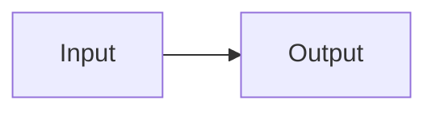
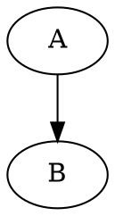

# Architecture medium

<div class="mf-columns"><section>中文卡片</section><section>Responsive</section></div>

## Section 0

中文与 Latin、emoji 🧪、**strong** 和 [anchor](#end)。 可靠的文档结构。 可靠的文档结构。 可靠的文档结构。 可靠的文档结构。 可靠的文档结构。 可靠的文档结构。 

- outer
  - nested
- [x] done

$E=mc^2$ 与 $\frac{a}{b}$。

| key | value |
| --- | --- |
| 0 | TABLE_0_0 |
| 1 | TABLE_0_1 |
| 2 | TABLE_0_2 |
| 3 | TABLE_0_3 |
| 4 | TABLE_0_4 |
| 5 | TABLE_0_5 |

```typescript
const value0 = "CODE_0_0";
const value1 = "CODE_0_1";
const value2 = "CODE_0_2";
const value3 = "CODE_0_3";
const value4 = "CODE_0_4";
const value5 = "CODE_0_5";
```

## Section 1

中文与 Latin、emoji 🧪、**strong** 和 [anchor](#end)。 可靠的文档结构。 可靠的文档结构。 可靠的文档结构。 可靠的文档结构。 可靠的文档结构。 可靠的文档结构。 

- outer
  - nested
- [x] done

$E=mc^2$ 与 $\frac{a}{b}$。

| key | value |
| --- | --- |
| 0 | TABLE_1_0 |
| 1 | TABLE_1_1 |
| 2 | TABLE_1_2 |
| 3 | TABLE_1_3 |
| 4 | TABLE_1_4 |
| 5 | TABLE_1_5 |

```typescript
const value0 = "CODE_1_0";
const value1 = "CODE_1_1";
const value2 = "CODE_1_2";
const value3 = "CODE_1_3";
const value4 = "CODE_1_4";
const value5 = "CODE_1_5";
```

## Section 2

中文与 Latin、emoji 🧪、**strong** 和 [anchor](#end)。 可靠的文档结构。 可靠的文档结构。 可靠的文档结构。 可靠的文档结构。 可靠的文档结构。 可靠的文档结构。 

- outer
  - nested
- [x] done

$E=mc^2$ 与 $\frac{a}{b}$。

| key | value |
| --- | --- |
| 0 | TABLE_2_0 |
| 1 | TABLE_2_1 |
| 2 | TABLE_2_2 |
| 3 | TABLE_2_3 |
| 4 | TABLE_2_4 |
| 5 | TABLE_2_5 |

```typescript
const value0 = "CODE_2_0";
const value1 = "CODE_2_1";
const value2 = "CODE_2_2";
const value3 = "CODE_2_3";
const value4 = "CODE_2_4";
const value5 = "CODE_2_5";
```

## Section 3

中文与 Latin、emoji 🧪、**strong** 和 [anchor](#end)。 可靠的文档结构。 可靠的文档结构。 可靠的文档结构。 可靠的文档结构。 可靠的文档结构。 可靠的文档结构。 

- outer
  - nested
- [x] done

$E=mc^2$ 与 $\frac{a}{b}$。

| key | value |
| --- | --- |
| 0 | TABLE_3_0 |
| 1 | TABLE_3_1 |
| 2 | TABLE_3_2 |
| 3 | TABLE_3_3 |
| 4 | TABLE_3_4 |
| 5 | TABLE_3_5 |

```typescript
const value0 = "CODE_3_0";
const value1 = "CODE_3_1";
const value2 = "CODE_3_2";
const value3 = "CODE_3_3";
const value4 = "CODE_3_4";
const value5 = "CODE_3_5";
```

## Section 4

中文与 Latin、emoji 🧪、**strong** 和 [anchor](#end)。 可靠的文档结构。 可靠的文档结构。 可靠的文档结构。 可靠的文档结构。 可靠的文档结构。 可靠的文档结构。 

- outer
  - nested
- [x] done

$E=mc^2$ 与 $\frac{a}{b}$。

| key | value |
| --- | --- |
| 0 | TABLE_4_0 |
| 1 | TABLE_4_1 |
| 2 | TABLE_4_2 |
| 3 | TABLE_4_3 |
| 4 | TABLE_4_4 |
| 5 | TABLE_4_5 |

```typescript
const value0 = "CODE_4_0";
const value1 = "CODE_4_1";
const value2 = "CODE_4_2";
const value3 = "CODE_4_3";
const value4 = "CODE_4_4";
const value5 = "CODE_4_5";
```

## Section 5

中文与 Latin、emoji 🧪、**strong** 和 [anchor](#end)。 可靠的文档结构。 可靠的文档结构。 可靠的文档结构。 可靠的文档结构。 可靠的文档结构。 可靠的文档结构。 

- outer
  - nested
- [x] done

$E=mc^2$ 与 $\frac{a}{b}$。

| key | value |
| --- | --- |
| 0 | TABLE_5_0 |
| 1 | TABLE_5_1 |
| 2 | TABLE_5_2 |
| 3 | TABLE_5_3 |
| 4 | TABLE_5_4 |
| 5 | TABLE_5_5 |

```typescript
const value0 = "CODE_5_0";
const value1 = "CODE_5_1";
const value2 = "CODE_5_2";
const value3 = "CODE_5_3";
const value4 = "CODE_5_4";
const value5 = "CODE_5_5";
```

## Section 6

中文与 Latin、emoji 🧪、**strong** 和 [anchor](#end)。 可靠的文档结构。 可靠的文档结构。 可靠的文档结构。 可靠的文档结构。 可靠的文档结构。 可靠的文档结构。 

- outer
  - nested
- [x] done

$E=mc^2$ 与 $\frac{a}{b}$。

| key | value |
| --- | --- |
| 0 | TABLE_6_0 |
| 1 | TABLE_6_1 |
| 2 | TABLE_6_2 |
| 3 | TABLE_6_3 |
| 4 | TABLE_6_4 |
| 5 | TABLE_6_5 |

```typescript
const value0 = "CODE_6_0";
const value1 = "CODE_6_1";
const value2 = "CODE_6_2";
const value3 = "CODE_6_3";
const value4 = "CODE_6_4";
const value5 = "CODE_6_5";
```

## Section 7

中文与 Latin、emoji 🧪、**strong** 和 [anchor](#end)。 可靠的文档结构。 可靠的文档结构。 可靠的文档结构。 可靠的文档结构。 可靠的文档结构。 可靠的文档结构。 

- outer
  - nested
- [x] done

$E=mc^2$ 与 $\frac{a}{b}$。

| key | value |
| --- | --- |
| 0 | TABLE_7_0 |
| 1 | TABLE_7_1 |
| 2 | TABLE_7_2 |
| 3 | TABLE_7_3 |
| 4 | TABLE_7_4 |
| 5 | TABLE_7_5 |

```typescript
const value0 = "CODE_7_0";
const value1 = "CODE_7_1";
const value2 = "CODE_7_2";
const value3 = "CODE_7_3";
const value4 = "CODE_7_4";
const value5 = "CODE_7_5";
```

## Section 8

中文与 Latin、emoji 🧪、**strong** 和 [anchor](#end)。 可靠的文档结构。 可靠的文档结构。 可靠的文档结构。 可靠的文档结构。 可靠的文档结构。 可靠的文档结构。 

- outer
  - nested
- [x] done

$E=mc^2$ 与 $\frac{a}{b}$。

| key | value |
| --- | --- |
| 0 | TABLE_8_0 |
| 1 | TABLE_8_1 |
| 2 | TABLE_8_2 |
| 3 | TABLE_8_3 |
| 4 | TABLE_8_4 |
| 5 | TABLE_8_5 |

```typescript
const value0 = "CODE_8_0";
const value1 = "CODE_8_1";
const value2 = "CODE_8_2";
const value3 = "CODE_8_3";
const value4 = "CODE_8_4";
const value5 = "CODE_8_5";
```

## Section 9

中文与 Latin、emoji 🧪、**strong** 和 [anchor](#end)。 可靠的文档结构。 可靠的文档结构。 可靠的文档结构。 可靠的文档结构。 可靠的文档结构。 可靠的文档结构。 

- outer
  - nested
- [x] done

$E=mc^2$ 与 $\frac{a}{b}$。

| key | value |
| --- | --- |
| 0 | TABLE_9_0 |
| 1 | TABLE_9_1 |
| 2 | TABLE_9_2 |
| 3 | TABLE_9_3 |
| 4 | TABLE_9_4 |
| 5 | TABLE_9_5 |

```typescript
const value0 = "CODE_9_0";
const value1 = "CODE_9_1";
const value2 = "CODE_9_2";
const value3 = "CODE_9_3";
const value4 = "CODE_9_4";
const value5 = "CODE_9_5";
```





## end
END_MEDIUM
