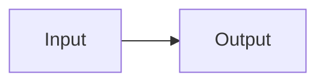
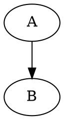

# Architecture small

<div class="mf-columns"><section>中文卡片</section><section>Responsive</section></div>

## Section 0

中文与 Latin、emoji 🧪、**strong** 和 [anchor](#end)。 可靠的文档结构。 可靠的文档结构。 可靠的文档结构。 可靠的文档结构。 可靠的文档结构。 可靠的文档结构。 

- outer
  - nested
- [x] done

$E=mc^2$ 与 $\frac{a}{b}$。

| key | value |
| --- | --- |
| 0 | TABLE_0_0 |
| 1 | TABLE_0_1 |
| 2 | TABLE_0_2 |
| 3 | TABLE_0_3 |
| 4 | TABLE_0_4 |
| 5 | TABLE_0_5 |

```typescript
const value0 = "CODE_0_0";
const value1 = "CODE_0_1";
const value2 = "CODE_0_2";
const value3 = "CODE_0_3";
const value4 = "CODE_0_4";
const value5 = "CODE_0_5";
```

## Section 1

中文与 Latin、emoji 🧪、**strong** 和 [anchor](#end)。 可靠的文档结构。 可靠的文档结构。 可靠的文档结构。 可靠的文档结构。 可靠的文档结构。 可靠的文档结构。 

- outer
  - nested
- [x] done

$E=mc^2$ 与 $\frac{a}{b}$。

| key | value |
| --- | --- |
| 0 | TABLE_1_0 |
| 1 | TABLE_1_1 |
| 2 | TABLE_1_2 |
| 3 | TABLE_1_3 |
| 4 | TABLE_1_4 |
| 5 | TABLE_1_5 |

```typescript
const value0 = "CODE_1_0";
const value1 = "CODE_1_1";
const value2 = "CODE_1_2";
const value3 = "CODE_1_3";
const value4 = "CODE_1_4";
const value5 = "CODE_1_5";
```





## end
END_SMALL
