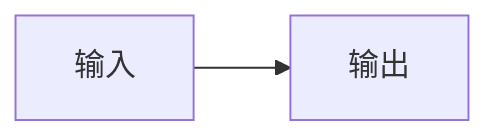

# HTML 基线：中文与 emoji 🧪

## 重复标题

正文 **强调**、`代码`、[链接](https://example.com)。

| 名称 | 值 |
| :--- | ---: |
| 中文 | 42 |

```markdown
## 围栏内不是标题
---pagebreak---
```

$$
\frac{1}{2}+x^2
$$



## 重复标题

<figure><figcaption>批准的语义结构</figcaption></figure>


